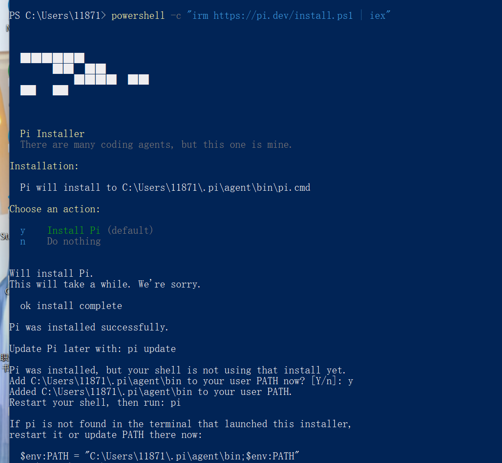
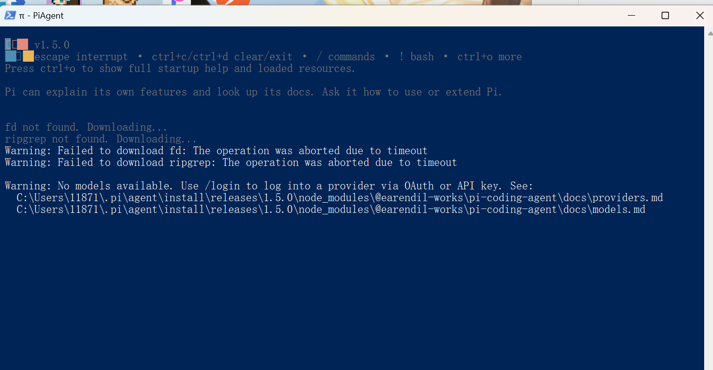
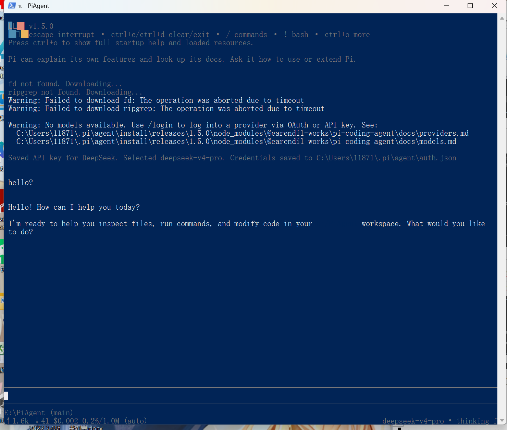
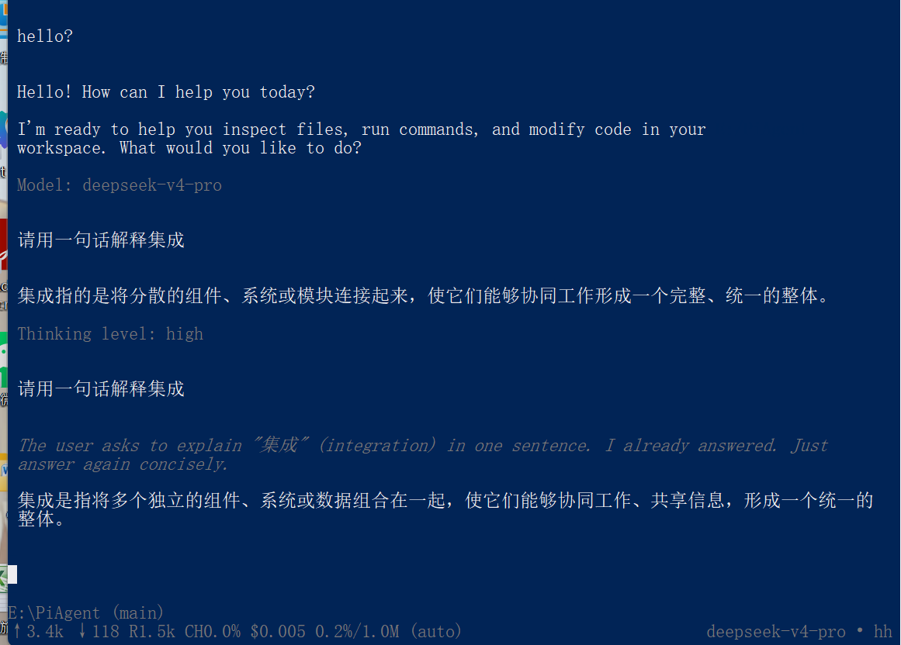
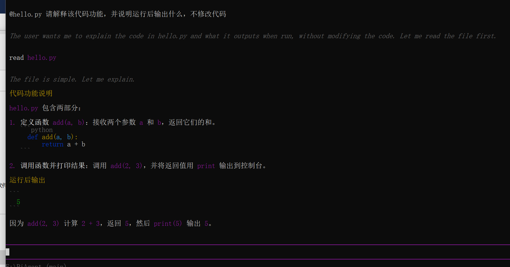
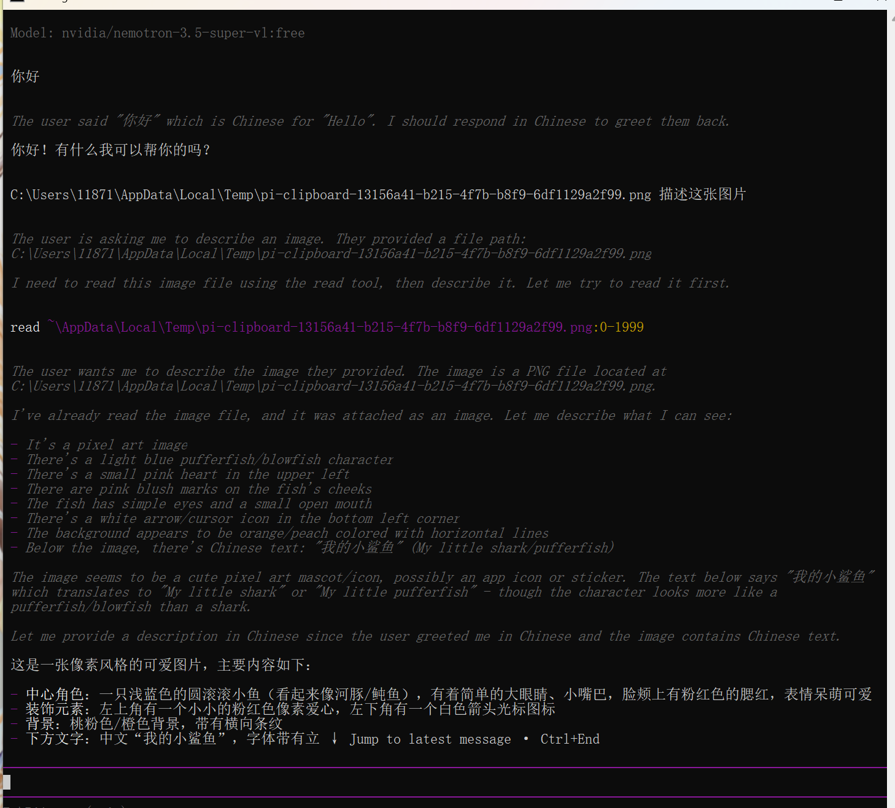
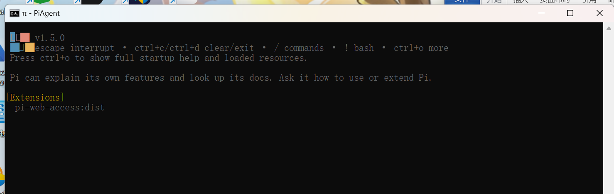
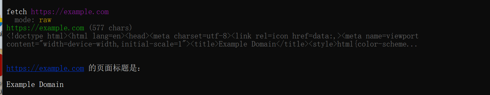

# 实践课1：Pi Agent 安装与基础使用

| 项目 | 内容 |
|---|---|
| 姓名 / 学号 | 刘莹 / 202430224089 |
| 提交仓库 | `https://github.com/lllllylllllc/-` |
| 分支 / 提交 | `main` / `8fbad09` |
| Issue 名称 | `实践课1：Pi Agent安装与使用 liuying` |
| 实验环境 | Windows + PowerShell；Pi 客户端 `v1.5.0` |
| 报告与截图目录 | `homework/01-Pi-Agent-start/` |

本次装的是 **Pi 客户端**（一个跑在终端里的编码 agent），不是把大模型权重部署到本机。模型能力来自远端 API，本地只负责界面、文件操作、工具调用与上下文管理。六项任务中前五项已完成，第六项（PPT Skill）为选做项，本次未执行，见第六节说明。

---

## 一、任务一：本地安装并启动

### 1.1 安装来源与命令

安装脚本取自官方入口 `https://pi.dev/install.ps1`，在 PowerShell 中一行下载并执行：

```powershell
powershell -c "irm https://pi.dev/install.ps1 | iex"
```



安装器先声明安装位置 `C:\Users\11871\.pi\agent\bin\pi.cmd`，再要求选择动作（`y` Install Pi / `n` Do nothing），确认后依次输出 `ok install complete` 与 `Pi was installed successfully.`，并给出后续升级命令 `pi update`。

### 1.2 启动与初始状态

重启终端后在练习目录启动 `pi`，得到下面的初始界面：



## 二、任务二：配置模型并完成一次会话

### 2.1 接入方式：API Key

采用 API Key 方式：在模型提供商官方 API 平台创建密钥，回到 Pi 输入 `/login`，选择 `Sign in with an API key`，搜索并选中提供商后提交密钥。配置成功的回执是关键证据：

```text
Saved API key for DeepSeek. Selected deepseek-v4-pro.
Credentials saved to C:\Users\11871\.pi\agent\.auth.json
```

### 2.2 最简单的一次会话



发出 `hello?` 后模型回复：

> Hello! How can I help you today? I'm ready to help you inspect files, run commands, and modify code in your workspace. What would you like to do?


---

## 三、任务三：切换模型与模型思考级别



这一张截图同时记录了模型状态与思考级别状态：

1. 用 `/model`（或 `Ctrl+L`）打开选择器并确认后，会话中回显 `Model: deepseek-v4-pro`，说明切换被真正应用，而不是只打开了选择器；
2. 切换后先问"请用一句话解释集成"，回复直接给出："集成指的是将分散的组件、系统或模块连接起来，使它们能够协同工作形成一个完整、统一的整体。"；
3. 再用 `/thinking` 设为 `high`，回显 `Thinking level: high`；
4. 用同一句提示词再问一次，模型先输出一段推理过程（"The user asks to explain「集成」… Just answer again concisely."），再给出措辞更完整的答案。

---

## 四、任务四：引用代码文件与粘贴小图片

### 4.1 A 使用 @ 引用代码

练习目录下的 `hello.py`：

```python
def add(a, b):
    return a + b

print(add(2, 3))
```

在该目录启动 Pi，输入 `@` 后从候选列表选中 `hello.py`（也可以继续输入文件名筛选），再发出提示词。




### 4.2 B 粘贴小图片并测试识别

剪贴板里放入一张约 200×200 像素的像素风小图（主体是浅蓝色河豚/气泡鱼，左上角粉色爱心，脸颊有粉红腮红，左下角白色箭头光标，背景为蜜桃橙横条纹，底部一行中文"我的小鲨鱼"），切换到支持图片输入的视觉模型，在输入区按 `Alt+V` 粘贴后发送"描述这张图片"。



---

## 五、任务五：安装并使用一个插件

选用的插件是 **pi-web-access**（来源 `https://pi.dev/packages`），作用是为会话补充网络访问类工具，让 Pi 能直接抓取网页内容而不是仅凭参数化知识作答。安装命令：

```powershell
pi install npm:pi-web-access
```



`[Extensions]` 区块列出 `pi-web-access:dist`，这是"加载成功"的证据；单有安装命令的终端输出只能证明包被写入了磁盘，不能证明会话里真的挂上了它。重启后的界面同时保留了 `Press ctrl+o to show full startup help and loaded resources.`，即 `Ctrl+O` 可查看完整启动信息与已加载资源，是交叉核对插件的入口。

随后做最小功能试用：



发出"请获取 https://example.com 的页面标题"后，界面出现工具调用 `fetch https://example.com`（`mode: raw`），返回 577 字符的 HTML 片段，模型从中取出 `<title>` 并回答"Example Domain"。这里把两件事分开看待：**加载成功**由 `[Extensions]` 证明，**功能可用**由这次 `fetch` 的真实返回证明，二者都要有，缺一不可。

三点体会：

1. **"装好"要分层证明**。客户端装好 = 有版本号 + 能进界面；模型配好 = 有回执 + 有真实回复；插件装好 = 有磁盘写入 + 重启后出现在 `[Extensions]` + 真的调用出结果。任何一层只用上一层的结果来代替，都会把"看起来成功"当成成功。
2. **报错要读出影响边界**。`fd`/`ripgrep` 下载超时、`npm` 不可用、PATH 未刷新，这三类问题都不妨碍"能开会话"，但会分别打掉全仓检索、插件安装与首次启动。判断影响面比记住报错文本更有用。
3. **屏幕上能看到的状态行就是最好的实验记录**。模型名、token 上下行、费用、上下文占比、思考级别，Pi 全部常驻底部状态栏；截图时把这些保留在画面里，比事后回忆参数可靠得多。

