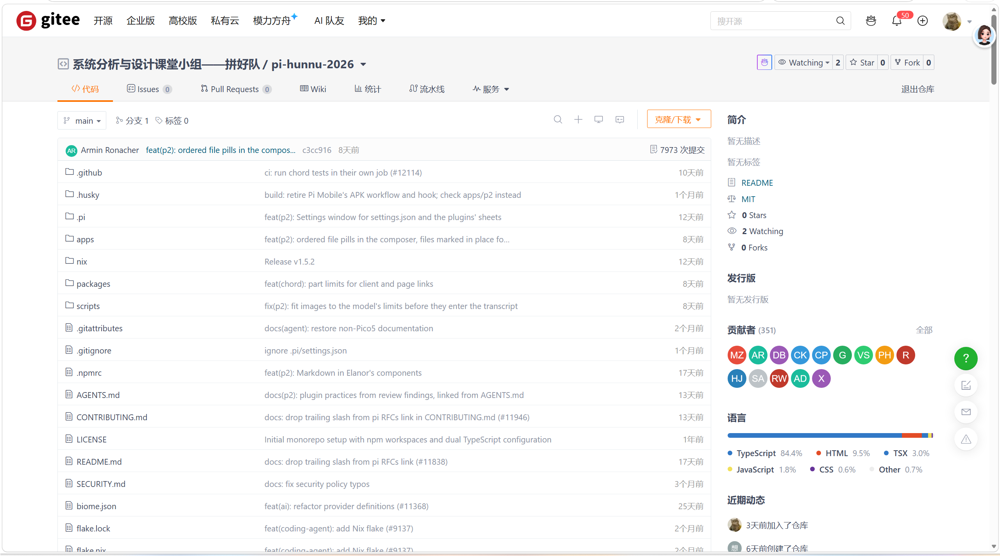
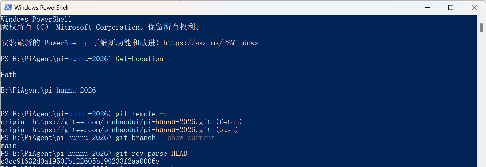
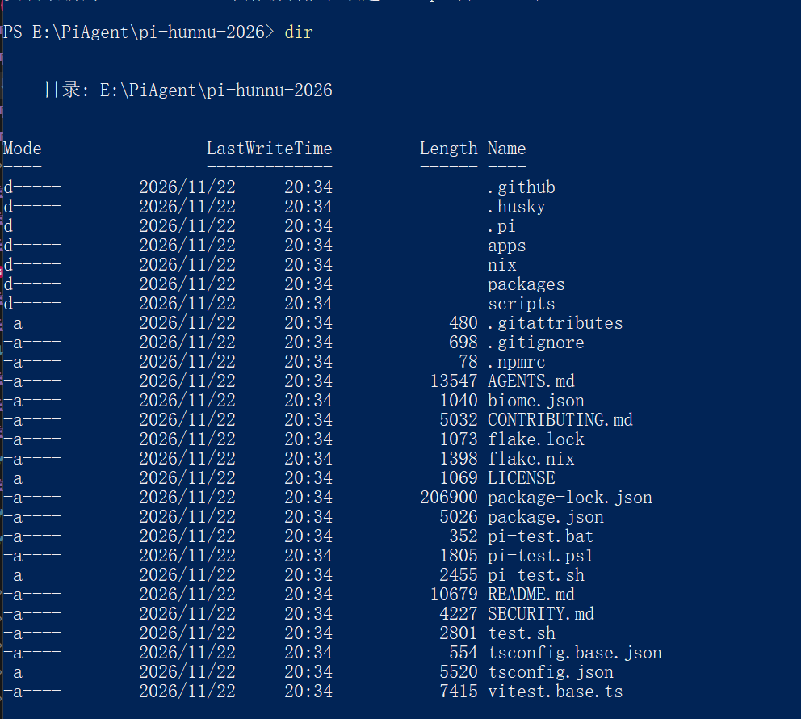
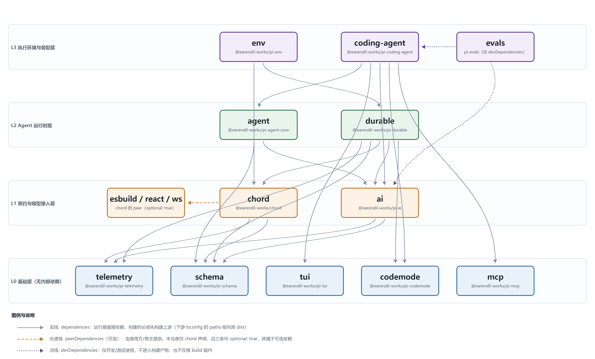
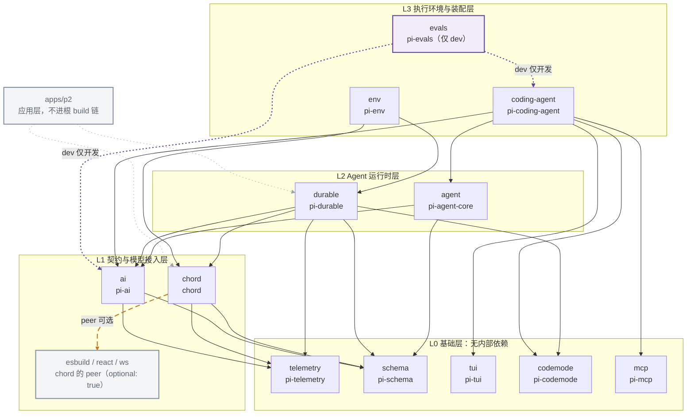

# 实践课2：组织建仓与源码分析

| 项目 | 内容 |
|---|---|
| 姓名 / 学号 | [刘莹] / [202430224089] |
| 小组 Organization | 系统分析与设计课堂小组——拼好队（Gitee） |
| 小组仓库 | `https://gitee.com/pinhaodui/pi-hunnu-2026` |
| 本地 clone 地址 | `https://gitee.com/pinhaodui/pi-hunnu-2026.git` |
| 分支 / 提交 | `main` / `c3cc91632d0a1950fb122605b190233f2aa0006e` |

---

## 一、源码获取

### 1.1 小组组织仓库



仓库地址栏上方显示命名空间为 **系统分析与设计课堂小组——拼好队 / pi-hunnu-2026**，即仓库属于小组组织而非个人账号；默认分支 `main`，最新提交 `c3cc916`（"feat(p2): ordered file pills in the composer…"），累计 7973 次提交，根目录可见 `packages/`、`apps/`、`scripts/` 等目录。

### 1.2 本地 clone 与版本确认



`git status --short` 无输出，说明工作区干净、与远端一致。三个要点：`origin` 指向**本小组组织仓库**（不是教师组织，也不是个人仓库）；当前分支为 `main`；完整提交编号 `c3cc91632d0a1950fb122605b190233f2aa0006e` 已记录，后续所有分析与构建均在该目录进行。

### 1.3 源码目录结构



`packages/` 下共 12 个目录：本次要求分析的 11 个模块，外加只用于评测的 `evals`；`apps/`（p2、p2-mac、p3）是应用层，不参与根构建链。这与课程模板给出的 11 个模块一致，差异部分见 3.1。

### 1.4 clone 地址（用于 Issue 正文）

```text
https://gitee.com/pinhaodui/pi-hunnu-2026.git
```

---

## 二、构建顺序：根脚本读什么、各模块做什么

### 2.1 根目录 `npm run build` 读什么配置、做什么

根 `package.json` 有两处关键声明（见 `package.json` 第 5–12 行与第 15 行）：

```json
"workspaces": ["packages/*", "apps/*", "packages/chord/test/examples/61-tutorial", "..."],
"scripts": {
  "build": "cd packages/telemetry && npm run build && cd ../schema && npm run build && cd ../chord && npm run build && cd ../tui && npm run build && cd ../codemode && npm run build && cd ../mcp && npm run build && cd ../ai && npm run build && cd ../durable && npm run build && cd ../env && npm run build && cd ../agent && npm run build && cd ../coding-agent && npm run build"
}
```

- `workspaces` 决定 `npm install` 会把 11 个包以 `@earendil-works/*` 的名字软链进根 `node_modules`，从而让包与包之间互相解析。
- `build` 本身**不编译任何代码**，它只是一条串行调度链，按固定次序切换到各包执行各自的 `build`。顺序为：
  `telemetry → schema → chord → tui → codemode → mcp → ai → durable → env → agent → coding-agent`。
- 根 `tsconfig.json` 是 `noEmit` 的全仓类型检查配置（`paths` 全部指向各包 `src`），只服务于 `npm run check` 里的 `tsc --noEmit`，与 build 无关。
- 另有一条 `build:offline`，与 `build` 的唯一差别是 `ai` 走 `build:offline`（跳过联网刷新模型数据，只做校验与编译）。

### 2.2 各模块 build 执行什么、生成什么

| 模块 | build 命令 | 额外动作 | 产物 |
|---|---|---|---|
| `telemetry` | `tsc -p tsconfig.build.json` | 无 | `dist/` 下 `.js` + `.d.ts` + `.d.ts.map` + `.js.map` |
| `schema` | `tsc -p tsconfig.build.json` | 无 | 同上 |
| `chord` | `tsc -p tsconfig.build.json` | 无（多子入口由 `package.json` 的 exports 暴露） | 同上 |
| `tui` | `tsc -p tsconfig.build.json` | 原生部分另用 `build:native:darwin/linux/win32`，默认 build 不含 | 同上；仓库已内置 `native/*/prebuilds/*.node` |
| `codemode` | `tsc -p tsconfig.build.json` | 靠 `files` 引入 `src/cloudflare-modules.d.ts` 环境声明 | 同上 |
| `mcp` | `tsc -p tsconfig.build.json` | 无 | 同上 |
| `ai` | `npm run generate-models && npm run build:offline` | ① 生成 `src/models.generated.ts`；② 校验模型数据是否最新；③ 编译；④ 拷贝 `src/providers/data` → `dist/providers/data` | 同上 + 生成的模型代码 + JSON 数据 |
| `durable` | `tsc -p tsconfig.build.json` | 靠 `paths` 指向 `../chord/dist`、`../ai/dist` 取类型 | 同上 |
| `env` | `tsc -p tsconfig.build.json` | Rust daemon 单独用 `build:daemon`（`cargo build`），不在根链 | 同上 |
| `agent` | `tsc -p tsconfig.build.json` | 靠 `paths` 指向 `../ai/dist` | 同上 |
| `coding-agent` | `npm run build:unbundled && node ../../scripts/build-coding-agent-bundle.mjs` | 编译后加可执行位、拷贝主题/图片/导出模板，再用 esbuild 打单文件 bundle | `dist/` 独立文件 + `dist/bundle`；另有 `build:binary`（`bun build --compile`，默认不执行） |

所有包的 `tsconfig.build.json` 都 `extends ../../tsconfig.base.json`，继承 `target ES2024`、`module Node16`、`strict`、`declaration` / `declarationMap` / `sourceMap`、`verbatimModuleSyntax`、`rewriteRelativeImportExtensions`，再各自声明 `outDir: ./dist`、`rootDir: ./src`。

> 说明：本机尚未执行完整构建（根目录还没有 `node_modules`），因此上表依据的是各包 `package.json` 的 build 脚本与 `tsconfig.build.json` 的编译设置，而非编造日志。若需补充实测，可执行 `npm ci --ignore-scripts` 后 `npm run build`，与 CI（`.github/workflows/ci.yml` 第 30、33 行）一致。

---

## 三、模块分析表

| 子文件夹 | 代码主要实现什么功能 | 本模块 build 执行什么、生成什么 | 直接依赖哪些内部模块 | 依据文件或代码位置 |
|---|---|---|---|---|
| `telemetry` | 厂商中立的遥测契约：基于回调的 `TelemetryContext` / `TelemetrySpan`、空实现 `NOOP_TELEMETRY_CONTEXT`、跨进程传播与 span link、计数器/上下计数器/直方图及带类型指标 schema、内存参考实现；不含 exporter、无全局 current-span | `tsc` 编译 `src/` → `dist/`，产出 JS、声明文件与 sourcemap | 无 | `packages/telemetry/README.md` 功能清单；`src/metrics.ts`、`src/noop.ts`、`src/memory.ts`；`tsconfig.build.json` |
| `schema` | JSON Schema 构造器与"无 eval"校验：schema 一次编译成闭包，支持 2020-12 与 draft-7，错误定位到 JSON Pointer，format 校验为可选子入口 | `tsc` 编译，只产出 `dist/`，无代码生成与资源拷贝 | 无 | `packages/schema/README.md` 首段；`src/compiler.ts`、`src/builders.ts`、`src/checks.ts`、`src/formats/` |
| `chord` | 跨进程对象运行时应用框架：对象类型契约（JSON Schema 描述）、facet 插件声明、只暴露引用、文档与事务持久化、derives/jobs、principal 隔离、按 host 热重载插件；多子入口 `/http`、`/workers`、`/plugins`、`/app`、`/sqlite`、`/react` 等 | `tsc` 全量编译 `src/` → `dist/`，不打包 | `pi-schema`、`pi-telemetry`；peer：`esbuild`、`react`、`ws`（三条均 `optional: true`） | `packages/chord/README.md` 入口点表；`src/host/`、`src/plugins/`、`src/store/`、`src/documents/`；`package.json` 的 deps 与 peerDeps |
| `tui` | 终端 UI 框架：差分渲染、CSI 2026 同步输出防闪烁、bracketed paste、组件模型（Editor/Markdown/SelectList/ScrollView 等）、Kitty/iTerm2 内联图、自动补全、按键绑定 | `tsc` 编译 `src/**/*` → `dist/`；原生 `.node` 另由 `build:native:*` 生成，默认 build 不含 | 无内部依赖；外部 `get-east-asian-width`、`marked`、`marked-cjk-friendly` | `packages/tui/README.md` Features；`src/tui.ts`、`src/tui-main-screen.ts`、`src/tui-alt-screen.ts`、`src/components/`；`package.json` scripts |
| `codemode` | 在 QuickJS(WASM) 沙箱中执行模型写的 JS：唯一能力是调用注入工具，嵌套工具调用不进入 LLM 上下文；三种沙箱（Node worker / Cloudflare DO / 内联） | `tsc` → `dist/`；`files` 引入 `cloudflare-modules.d.ts` 环境声明 | 无（明确不依赖其他 pi 包）；外部 `quickjs-wasi` | `packages/codemode/README.md` 首段与环境表；`src/wasm.ts`、`src/source.ts`、`src/runtime/`；`tsconfig.build.json` 的 `files` |
| `mcp` | 独立 Model Context Protocol 客户端，不用官方 SDK：传输无关 client core、stdio 与 Streamable HTTP 传输、管道 stdio、内存测试传输，另含 `oauth/`、`protocol/` | `tsc` → `dist/` | 无；外部 `cross-spawn` | `packages/mcp/README.md` 首段；`src/client.ts`、`src/transports/`、`src/protocol/`、`src/oauth/` |
| `ai` | 统一 LLM 接入层：provider 集合与模型目录、鉴权解析（OAuth/环境变量）、token 与成本统计、上下文持久化与中途换模型、工具定义与 partial JSON 流式解析、图像/分类模型目录 | 生成模型源码 → 校验生成物 → `tsc` → 拷贝 `providers/data` 到 `dist` | `pi-schema`、`pi-telemetry`；外部 Anthropic/OpenAI/Google/Bedrock SDK 等 | `packages/ai/package.json` 的 `build` / `build:offline`；`catalog/generate.ts`；`scripts/check-model-data.ts`；`src/models.generated.ts` 首行注释 |
| `durable` | 实验性耐久 agent harness：会话、模型轮次、工具调用先落存储再显示，崩溃后可续跑、失败尝试可重试；含 `session/`、`storage/`、`harness/`、`tools/`、`tool-search/`、`codemode/`、`env/` 子域 | `tsc` → `dist/`；`paths` 直接指向 `../chord/dist/*.d.ts` 与 `../ai/dist/index.d.ts` | `chord`、`pi-ai`、`pi-codemode`、`pi-schema`、`pi-telemetry` | `packages/durable/README.md` 首段；`tsconfig.build.json` 的 `paths`；`src/harness/`、`src/storage/`、`src/session/` |
| `env` | 为 durable 提供远程执行环境：工具在远端经 SSH 执行，durable 的 worker/存储/凭据留本地；`daemon/` 是 Rust 小程序，按 framed 协议走 stdin/stdout | `tsc` → `dist/`；daemon 用 `build:daemon` 单独编译，不在根链 | `chord`、`pi-durable` | `packages/env/README.md` 首段；`daemon/Cargo.toml`；`docs/protocol.md`；`tsconfig.build.json` 的 `paths`；`ci.yml` 中单独的 `build:daemon` 步骤 |
| `agent` | 有状态 agent 内核：agent loop、工具执行、事件流式输出、可中断与代理包装，构建在 `pi-ai` 之上 | `tsc` → `dist/`；`paths` 指向 `../ai/dist/index.d.ts` | `pi-ai`、`pi-schema` | `packages/agent/README.md` 首段；`src/agent.ts`、`src/agent-loop.ts`、`src/stream-fn.ts`、`src/proxy.ts`、`src/types.ts` |
| `coding-agent` | 用户实际运行的 Pi 本体：交互 TUI、print/JSON、RPC 三种模式；扩展、skill、prompt 模板、主题、包管理、HTML 导出 | `build:unbundled`（`tsc` + 加可执行位 + 拷贝资源）+ esbuild 打单文件 bundle；`build:binary` 另出单文件可执行 | `pi-agent-core`、`pi-ai`、`pi-codemode`、`pi-mcp`、`pi-tui` | `packages/coding-agent/package.json` scripts；`scripts/build-coding-agent-bundle.mjs`；`tsconfig.build.json` 的 `paths`；`src/cli/`、`src/modes/`、`src/extensions/` |

### 3.1 与课程模板的差异

模板列出 11 个模块，本版本 `packages/` 下有 12 个目录：

- 新增 `evals`：只放评测与测试用例，`devDependencies` 依赖 `pi-ai` 与 `pi-coding-agent`，**不在根构建链**，因此不纳入模块分析表，但在依赖图中以开发依赖点线标出。
- 另有 `apps/`（p2、p2-mac、p3）为应用层：`p2` 依赖 `chord`、`ai`、`durable`、`env`、`mcp`、`schema`、`telemetry`、`tui`，`p3` 依赖 `chord`、`schema`、`telemetry`，也都不在根 build 链内。这说明根 `build` 只覆盖"库"，应用由其自身脚本构建。

### 3.2 本人重点分析的模块

重点放在 `telemetry`、`schema`、`chord` 三个基础模块：`schema` 与 `telemetry` 是全仓零内部依赖的两块地基，`chord` 是第一个把二者组合起来的模块，也是唯一声明 peerDependencies 的模块，因此我通过它确认了"可选依赖"在本仓库中的真实形态（`peerDependenciesMeta` 里 `optional: true`，而不是 `optionalDependencies` 字段）。其余模块由组员分工细读，我负责交叉核对依赖声明与构建脚本。

---

## 四、依赖关系图

### 4.1 图



### 4.2 图例：三类依赖如何区分

| 线型 | 对应字段 | 含义 | 本仓库实际情况 |
|---|---|---|---|
| 实线（灰） | `dependencies` | 运行期直接依赖，构建时必须先构建上游 | 18 条 |
| 橙色长虚线 | `peerDependencies` + `peerDependenciesMeta` | 由使用方/宿主提供，本包不打包 | 仅 `chord` 声明 `esbuild`、`react`、`ws`，三条均 `optional: true` |
| 紫色点线 | `devDependencies` | 仅开发/测试使用，不进构建产物、不在根 build 链 | 仅 `evals` 依赖 `pi-ai`、`pi-coding-agent` |

### 4.3 层级划分依据

按"该模块向下最长的一条依赖链长度"分层：深度 0 表示 `dependencies` 中不含任何其他 pi 包。

- **L0**：`telemetry`、`schema`、`tui`、`codemode`、`mcp`（零内部依赖）；
- **L1**：`chord`（依赖 `schema`、`telemetry`）、`ai`（依赖 `schema`、`telemetry`）；
- **L2**：`agent`（经 `ai` 得 2）、`durable`（经 `chord`、`ai` 得 2）；
- **L3**：`env`（经 `durable` 得 3）、`coding-agent`（经 `agent` 得 3）。

层级并非构建顺序的复制：构建顺序把 `agent` 排在 `env` 之后，但两者层级不同，见 5.2。

### 4.4 图源

可编辑图源见同目录 `模块依赖图.mmd`（Mermaid，含 `linkStyle` 区分三类线型），内容如下：



> 注：同目录下的 `模块依赖图.png` 是早期版本（只画 `dependencies`），正文以 `模块依赖图-三类依赖.png` 为准。

---

## 五、三个问题

### 5.1 根目录与子模块的 `npm run build` 分别读取什么配置、执行什么工作？

**根目录**读根 `package.json` 的 `workspaces` 与 `scripts.build`。`workspaces` 决定 `npm install` 时把各包软链到 `node_modules/@earendil-works/*`；`scripts.build` 是一条串行 `cd` + `npm run build` 链，自己不编译代码，也不读 tsconfig——根 `tsconfig.json` 是 `noEmit` 的全仓类型检查配置，只给 `npm run check` 用。

**子模块**读两个文件：自身 `package.json`（决定执行什么命令、依赖谁）与 `tsconfig.build.json`（决定编译范围与产物）。所有 `tsconfig.build.json` 都继承根 `tsconfig.base.json`（ES2024、Node16、`strict`、`declaration` + `declarationMap` + `sourceMap`、`verbatimModuleSyntax`、`rewriteRelativeImportExtensions`），再声明 `outDir: ./dist`、`rootDir: ./src`。工作内容分两类：9 个包是纯 `tsc`，把 `src` 编成 `dist` 里的 JS 与声明；3 个包有额外交付——`ai` 先生成模型源码再编译并拷贝 JSON 数据，`coding-agent` 编译后加可执行位、拷资源并打 bundle，`tui`/`env` 的原生构建走单独脚本。

一句话：根 `build` 是调度器，子模块 `build` 是编译器，最终产物是 11 份 `dist`，供下游按 `paths` 取 `.d.ts`。

### 5.2 构建顺序和模块依赖有什么关系？相邻构建的模块一定互相依赖吗？

顺序由依赖推导，但**是人工写死的**：根 `package.json` 那一行 `&&` 链就是唯一事实来源。它成立的直接原因是下游 `tsconfig.build.json` 的 `paths` 指向上游的 **`dist`** 而不是 `src`：

- `durable` → `../chord/dist/index.d.ts`、`../ai/dist/index.d.ts`
- `env` → `../chord/dist/context/index.d.ts`、`../durable/dist/env/index.d.ts`
- `agent` → `../ai/dist/index.d.ts`
- `coding-agent` → `../agent/dist/index.d.ts`、`../ai/dist/index.d.ts`、`../tui/dist/index.d.ts`

`dist` 不存在时 `tsc` 直接报找不到模块，所以"上游先 build"是硬约束；运行期同理，包间引用的也是已构建的 `dist`。

**相邻不等于互相依赖**。10 个相邻对中只有 4 对是真依赖：`schema → chord`、`ai → durable`、`durable → env`、`agent → coding-agent`。其余 6 对只是顺序相邻：`telemetry → schema`（schema 零依赖）、`chord → tui`、`tui → codemode`、`codemode → mcp`、`mcp → ai`（mcp 明确独立于 ai）、`env → agent`（agent 只依赖 ai 与 schema）。

顺序也不唯一：`tui`、`codemode`、`mcp` 三者无依赖可任意换位，`agent` 只等 `ai`，完全可以排在 `env` 之前。现有链只是一条合法拓扑序，不能当成层级的严格映射。

### 5.3 一条至少三个模块的依赖路径，各模块如何分工？

取 `coding-agent → agent(pi-agent-core) → ai → schema`：

- **`schema`**：数据契约与校验底座。工具参数、状态文档、插件契约都用它声明为 JSON Schema 并编译成闭包校验，"什么输入合法"只有一个出处，且不依赖 `eval`。
- **`ai`**：协议翻译层。用 `schema` 校验工具入参，向上提供统一的 provider 适配、鉴权、流式 chunk、工具调用（partial JSON 流式解析）、token 与成本、模型目录；上层不必区分 Anthropic 还是 OpenAI。
- **`agent`**：单会话状态机。消费 `ai` 的流，维护消息历史，驱动 agent loop，调度工具执行，把过程以事件流抛出，并处理中断与重试。
- **`coding-agent`**：装配与交付层。把 `agent` 装进交互 TUI、print/JSON、RPC 三种模式，挂载扩展、skill、主题、包管理，完成资源拷贝与 esbuild 打包，决定用户实际怎么用。

递进关系是：契约（schema）→ 模型协议（ai）→ 会话推进（agent）→ 用户形态（coding-agent）。若换一条路径，`chord` 提供对象与文档的跨进程生命周期，`telemetry` 提供可观测名义，`durable` 把会话变成可崩溃恢复的存储状态，`env` 再把工具执行从本机搬到远端。

---
