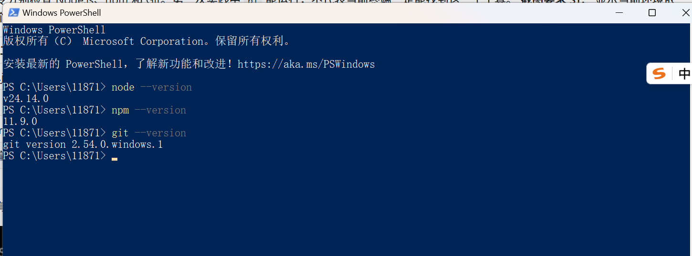
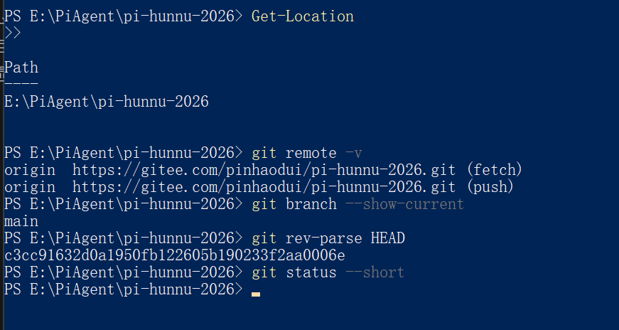
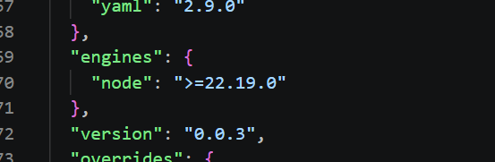
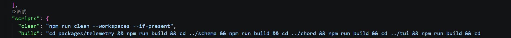
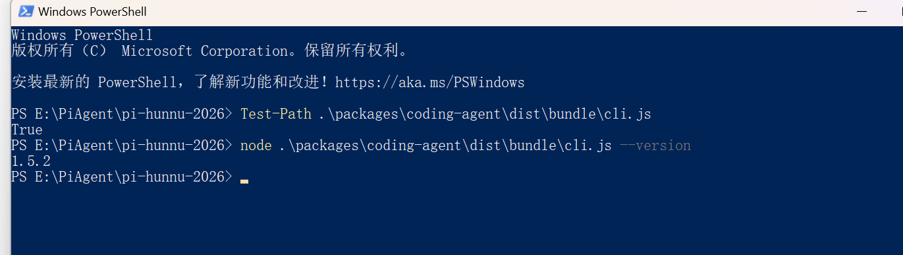
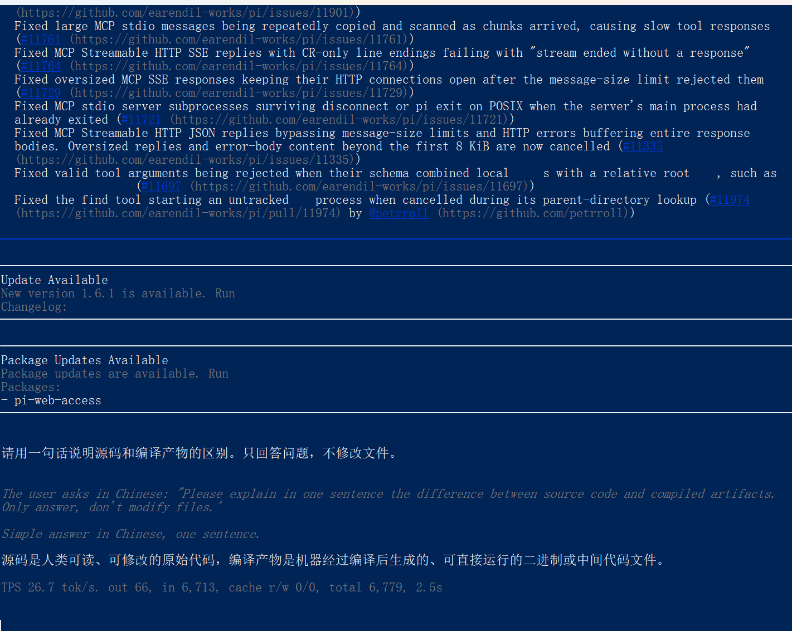
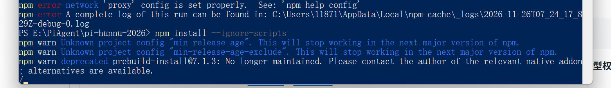

# 实践课3：Pi Agent 源码获取、依赖安装与本地编译

| 项目 | 内容 |
|---|---|
| 姓名 / 学号 | 刘莹 / 202430224089 |
| 小组 Organization | 系统分析与设计课堂小组——拼好队（Gitee 组织） |
| 小组仓库（组内 fork） | `https://gitee.com/pinhaodui/pi-hunnu-2026` |
| 本地源码目录 | `E:\PiAgent\pi-hunnu-2026`（全英文路径） |
| 分支 / 提交 | `main` / `c3cc91632d0a1950fb122605b190233f2aa0006e` |
| 实验环境 | Windows + PowerShell；Node.js `v24.14.0`、npm `11.9.0`、Git `2.54.0.windows.1` |
| 本地构建版本 | `1.5.2`（取自 `packages/coding-agent/package.json`） |
| 报告与截图目录 | `homework/03-Pi-Agent-source-build/` |
| 提交仓库 | `https://github.com/lllllylllllc/-` |
| Issue 名称 | `实践课3：Pi Agent源码安装与编译 liuying` |

四个问题的答案
| 问题 | 本次答案 |
|---|---|
| 源码在哪里 | `E:\PiAgent\pi-hunnu-2026`，分支 `main`，提交 `c3cc91632d0a1950fb122605b190233f2aa0006e` |
| 依赖装在哪里 | 仓库根 `node_modules`；12 个内部包经 npm workspaces 软链接到 `node_modules\@earendil-works\*`，未装成全局包 |
| 构建执行了什么 | 根 `npm run build:offline` 串行调度 11 个包：`tsc` 把各包 `src` 编成 `dist`，`ai` 先校验模型数据并拷贝 JSON，`coding-agent` 最后用 esbuild 打成单文件 bundle |
| 正在运行哪个版本 | 本地源码版 `1.5.2`（`.\pi-test.bat` 直接跑 `src/cli.ts`；`dist\bundle\cli.js --version` 同样输出 `1.5.2`） |

---

## 一、任务一：实验准备与版本记录




*图1 本次实际版本：Node.js v24.14.0、npm 11.9.0、Git 2.54.0.windows.1。*

三条命令分别检查 Node.js、npm 与 Git。第一次实践课里 `pi` 能跑，只证明全局 `pi` 命令存在，不代表当前终端找得到这三个工具——所以这一步必须重新做，而不是靠"上次装过"推断。

- **Node.js `v24.14.0`**：仓库根 `package.json` 的 `engines.node` 只要求 `>=22.19.0`（见第三节图3），24 是当前的 LTS 线，留出了余量。
- **npm `11.9.0`**：随 Node 24 的官方安装包一起装上的，没有另外下载，也没有单独升级。
- **Git `2.54.0.windows.1`**：同时提供 `git` 命令与 Git Bash，本实验只用到 `git` 命令。

## 二、任务二：下载源码并确认来源与版本

用五条命令核对"这份代码到底是谁的、哪个版本"：

```powershell
Get-Location
git remote -v
git branch --show-current
git rev-parse HEAD
git status --short
```




## 三、任务三：读配置，确认安装与编译的依据

### 3.1 Node.js 版本要求写在哪里



*图3 根 `package.json` 第 68–73 行，`engines.node` 为 `>=22.19.0`。*

**回答：** 版本要求写在**根 `package.json` 的 `engines` 字段**，不是写在 `tsconfig.json`，也不是写在 `.npmrc`。它只约束这个仓库根项目；真正跑起来时，各依赖包还会用自己声明的范围再限一次（例如上面提到的 gondolin 要 `>=23.6.0`），所以本次实验统一用 Node 24 LTS。`engines` 本身只是"声明"，npm 默认不会因为版本不符而中止安装，更多是以 `EBADENGINE` 警告的形式出现。

### 3.2 `npm run build` 实际从哪里读取命令




*图4 根 `package.json` 第 13–16 行：`scripts` 里有 `clean`、`build`、`build:offline` 等。*

**回答：** `npm run build` 读取的是**执行命令时当前目录下 `package.json` 的 `scripts.build` 字段（第 15 行）**。npm 做的事只有两件：取出这个字符串、交给 shell（本机是 `cmd.exe /d /s /c`）执行。这条字符串本身只是一条串行调度链，`&&` 保证前一步成功才继续；链里每个 `npm run build` 又会切换目录，读**该子包自己的 `package.json`** 的 `scripts.build`，再由子包里的 `tsc -p tsconfig.build.json` 决定编译范围与产物。

所以：**根 `build` 是调度器，子包 `build` 才是编译器**。npm 不认识 `tsc`、不读 `tsconfig`，这些都由子包脚本自己决定。


## 四、任务四：安装项目依赖

### 4.1 安装结果与输出解读


*图5 安装结束时的输出：4 条 `npm warn`、1 条 `deprecated`，以及 `changed 33 packages in 6m` 和 `57 packages are looking for funding`，最后回到提示符。*

## 五、任务五：本地编译与构建产物验证

### 5.1 构建结束与产物检查


*图6 构建的最后一段：`coding-agent@1.5.2 build → build:unbundled`（`tsc -p tsconfig.build.json` + 加可执行位 + `copy-assets`）→ esbuild 打包，最后打印 `Built packages\coding-agent\dist\bundle (84 files, 9.4 MiB)` 并回到提示符。*



*图7 `Test-Path .\packages\coding-agent\dist\bundle\cli.js` 输出 `True`；`node .\packages\coding-agent\dist\bundle\cli.js --version` 输出 `1.5.2`。*


## 六、任务六：启动本地源码版本并完成一次会话

### 6.1 启动与界面证据


*图8 启动后的界面：标题栏 `π - pi-hunnu-2026`，版本行 `v1.5.2`，下方列出 `[Context] AGENTS.md`、`[Skills]`、`[Prompts]`、`[Extensions]`。*

界面上半部分直接暴露了它加载的是哪个仓库的资源：

- `[Context] AGENTS.md`：仓库根的 `AGENTS.md`；
- `[Skills]` 列出 `add-llm-provider`、`github-work`、`interactive-testing`、`release`，来自仓库 `.pi/skills/`（该目录下共 5 个 `.md`，界面按配置只挂了这 4 个）；
- `[Prompts]` 的 `/cl`、`/deslop`、`/dup`、`/is`、`/pr`、`/sa`、`/wr` 来自 `.pi/prompts/`；
- `[Extensions]` 列出 `import-repro.ts`、`pi-web-access:dist`、`prompt-url-widget.ts`、`redraws.ts`、`tps.ts`，与 `.pi/extensions/` 里的文件对得上。

这些是仓库自带的上下文与扩展，全局安装的 `pi` 不会带上它们——这是"跑的是本地源码"最直观的一层证据。

### 6.2 一次真实会话



*图9 提示词、模型回复与用量指标。*

模型回复原文：

> 源码是人类可读、可修改的原始代码，编译产物是机器经过编译后生成的、可直接运行的文件。

底部指标 `TPS 26.7 tok/s. out 66, in 6,713, cache r/w 0/0, total 6,779, 2.5s` 说明这是一次真实的模型调用（输入 6713 token 主要是系统提示与上下文），而不是本地模拟；同时程序没有写任何文件，符合"只回答问题，不修改文件"的约束。

关于登录：本次没有重新 `/login`，因为本地源码版与全局版共用当前用户配置目录 `~/.pi/agent`，第一次实践课的凭据仍然有效。**这只能说明"复用了用户配置"，不能说明"跑的是全局版本"**——运行哪个版本要看启动命令和界面资源，不能看"能不能直接聊天"。

### 6.3 两个问题

**（1）本次如何确保运行的是本地源码？**

三层证据合起来看：

1. **启动命令**：在仓库根目录执行 `.\pi-test.bat`。它先调用 `pi-test.ps1`，脚本第 62–64 行是 `node --import <repo>\packages\coding-agent\src\experimental\source-resolver.ts <repo>\packages\coding-agent\src\cli.ts`——直接用 node 加载仓库里的 TypeScript 源码入口，既不经过 `dist/bundle`，也不经过全局 `pi` 命令。脚本名带 `test`，但它不是测试套件入口。
2. **界面资源**：标题 `π - pi-hunnu-2026`、`v1.5.2`，以及 `[Context]`/`[Skills]`/`[Prompts]`/`[Extensions]` 都是仓库内文件。
3. **版本对齐**：界面版本与 `packages/coding-agent/package.json` 的 `1.5.2` 一致；全局版是第一次课装的另一个版本，且不会加载本仓库的扩展清单。

**（2）源码入口与 `dist/bundle/cli.js` 入口分别适合什么场景？**

| 入口 | 启动方式 | 适合的场景 | 代价 |
|---|---|---|---|
| 源码入口 | `.\pi-test.bat` → `src/cli.ts` | 开发调试：改 `src` 立即生效，可加日志、打断点，不用每轮都 build | 首次启动要现场解析 TS，略慢；依赖本地依赖树 |
| 构建产物入口 | `node .\packages\coding-agent\dist\bundle\cli.js` | 验证构建结果、接近发版形态、分发给别人、日常使用（启动快、自包含 84 个文件） | 改源码后必须重新构建才生效 |

两者共用 `~/.pi/agent`，所以会话、凭据、模型配置是同一份，区别只在"跑的是哪套代码"。作业里的验证思路也是这个分工：源码入口证明"开发环境可用"，bundle 入口证明"构建产物可用"。

## 七、困难与解决过程

### 7.1 npm 网络报错：`'proxy' config is set properly`



*图10 `npm error network 'proxy' config is set properly.`*

**现象**：一开始执行 `npm install` 直接以 `npm error network 'proxy' config is set properly.` 失败，并提示完整日志在 `...\npm-cache\_logs\...-debug-0.log`。

**处理**：先用 `npm config get proxy`、`npm config get https-proxy` 确认是否非空，再用 `npm config delete proxy`、`npm config delete https-proxy` 清掉，然后关掉旧窗口、重开 PowerShell 再装。清掉之后 `npm install` 能正常走完（图5）。

### 7.2 构建卡在 `Fetching models.dev catalog...`


*图11 `packages/ai` 执行 `node catalog/generate.ts --strict`，停在 `Fetching models.dev catalog...`。*

**现象**：`npm run build` 走到 `@earendil-works/pi-ai@1.5.2` 的 `generate-models` 阶段，日志停在 `Fetching models.dev catalog...` 不动；按 Ctrl+C 终止后重试，报错逐步变成：

```text
Failed to fetch Radius models: [TypeError: fetch failed] {
  [cause]: ConnectTimeoutError: Connect Timeout Error (attempted addresses: 172.67.221.13:443, timeout: 10000ms)
      at onConnectTimeout (node:internal/deps/undici/undici:1936:23) {
    code: 'UND_ERR_CONNECT_TIMEOUT'
  }
}
npm error Lifecycle script `generate-models` failed with error:
npm error code 1
```

后来直接卡在第一个源：`Failed to fetch models.dev catalog`，尝试的地址是 `172.67.220.122:443`、`104.21.51.36:443` 等。

**处理**：更换网络。