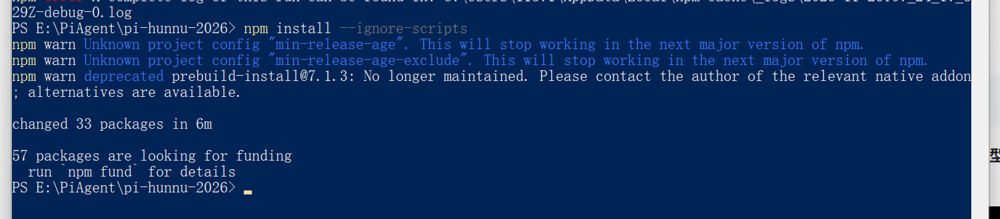
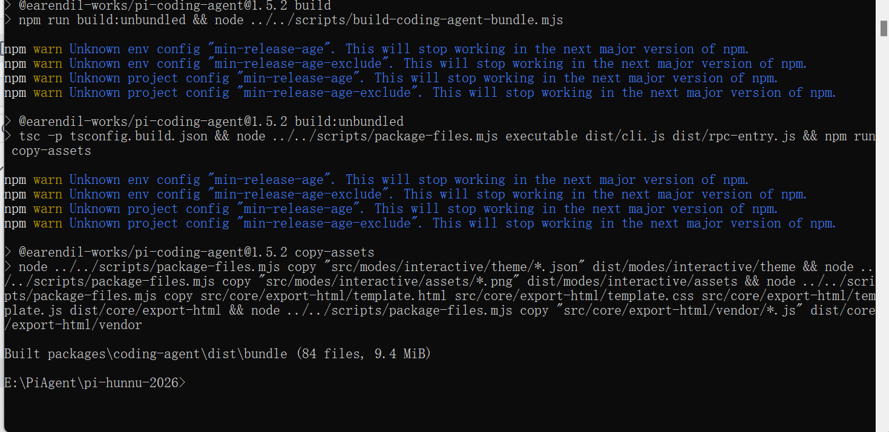
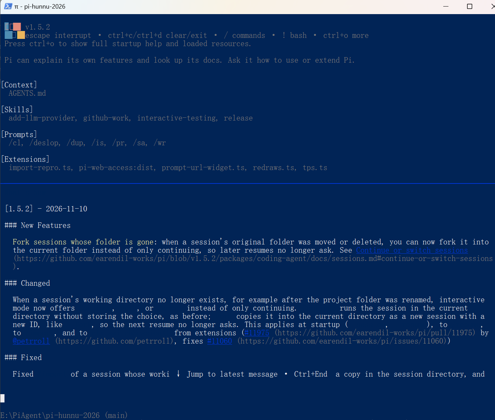
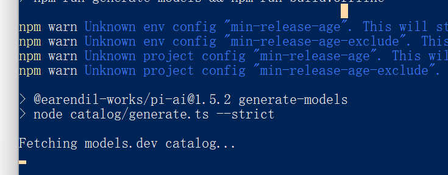

# 实践课3：Pi Agent 源码获取、依赖安装与本地编译

| 项目 | 内容 |
|---|---|
| 姓名 / 学号 | 刘莹 / 202430224089 |
| 小组 Organization | 系统分析与设计课堂小组——拼好队（Gitee 组织） |
| 小组仓库（组内 fork） | `https://gitee.com/pinhaodui/pi-hunnu-2026` |
| 本地源码目录 | `E:\PiAgent\pi-hunnu-2026`（全英文路径） |
| 分支 / 提交 | `main` / `c3cc91632d0a1950fb122605b190233f2aa0006e` |
| 实验环境 | Windows + PowerShell；Node.js `v24.14.0`、npm `11.9.0`、Git `2.54.0.windows.1` |
| 本地构建版本 | `1.5.2`（取自 `packages/coding-agent/package.json`） |
| 报告与截图目录 | `homework/03-Pi-Agent-source-build/` |
| 提交仓库 | `https://github.com/lllllylllllc/-` |
| Issue 名称 | `实践课3：Pi Agent源码安装与编译 liuying` |

本次只建立本地源码开发环境，没有构建独立 EXE，也没有下载任何大模型权重。先给四个问题的答案，细节在正文各节：

| 问题 | 本次答案 |
|---|---|
| 源码在哪里 | `E:\PiAgent\pi-hunnu-2026`，分支 `main`，提交 `c3cc91632d0a1950fb122605b190233f2aa0006e` |
| 依赖装在哪里 | 仓库根 `node_modules`；12 个内部包经 npm workspaces 软链接到 `node_modules\@earendil-works\*`，未装成全局包 |
| 构建执行了什么 | 根 `npm run build:offline` 串行调度 11 个包：`tsc` 把各包 `src` 编成 `dist`，`ai` 先校验模型数据并拷贝 JSON，`coding-agent` 最后用 esbuild 打成单文件 bundle |
| 正在运行哪个版本 | 本地源码版 `1.5.2`（`.\pi-test.bat` 直接跑 `src/cli.ts`；`dist\bundle\cli.js --version` 同样输出 `1.5.2`） |

---

## 一、任务一：实验准备与版本记录

在原生 Windows PowerShell 窗口（不是 VS Code 内置终端）里逐条执行三条检查命令：

```powershell
node --version
npm --version
git --version
```


*图1 本次实际版本：Node.js v24.14.0、npm 11.9.0、Git 2.54.0.windows.1。*

三条命令分别检查 Node.js、npm 与 Git。第一次实践课里 `pi` 能跑，只证明全局 `pi` 命令存在，不代表当前终端找得到这三个工具——所以这一步必须重新做，而不是靠"上次装过"推断。

- **Node.js `v24.14.0`**：仓库根 `package.json` 的 `engines.node` 只要求 `>=22.19.0`（见第三节图3），24 是当前的 LTS 线，留出了余量。作业文档图2 里 Node 22.23.2 触发 `EBADENGINE`，是因为旧分支的 `@earendil-works/gondolin@0.12.0` 声明需要 `>=23.6.0`，可见"满足根项目最低版本"不等于"满足每个依赖"；本次直接用 24，安装与构建全程没有出现 `EBADENGINE`。
- **npm `11.9.0`**：随 Node 24 的官方安装包一起装上的，没有另外下载，也没有单独升级。
- **Git `2.54.0.windows.1`**：同时提供 `git` 命令与 Git Bash，本实验只用到 `git` 命令。

## 二、任务二：下载源码并确认来源与版本

源码按第二次实践课的组织仓库下载，仍然放在英文目录下：

```powershell
git clone --branch main https://gitee.com/pinhaodui/pi-hunnu-2026.git
cd pi-hunnu-2026
```

随后用五条命令核对"这份代码到底是谁的、哪个版本"：

```powershell
Get-Location
git remote -v
git branch --show-current
git rev-parse HEAD
git status --short
```


*图2 `Get-Location`、`git remote -v`、`git branch --show-current`、`git rev-parse HEAD`、`git status --short` 的实际输出。*

- `Get-Location` 输出 `E:\PiAgent\pi-hunnu-2026`，全英文路径，避免后续工具对中文路径的兼容问题。
- `git remote -v` 两行都指向 `https://gitee.com/pinhaodui/pi-hunnu-2026.git`，即**本小组组织内的 fork 仓库**，既不是教师组织仓库，也不是个人仓库。
- `git branch --show-current` 为 `main`，`git rev-parse HEAD` 为 `c3cc91632d0a1950fb122605b190233f2aa0006e`，这个完整编号要写进报告，后面所有安装、构建都在这个提交上完成。
- `git status --short` 没有任何输出，说明工作区干净、与远端一致，不存在"本地有未提交改动却被当成原始代码"的情况。

仅打开 GitHub/Gitee 网页只能证明"网页上能看到这份代码"，不能证明代码已经落到本地这台机器；上面五条命令加上后面的构建，才构成"本地确有这份源码"的证据。

## 三、任务三：读配置，确认安装与编译的依据

### 3.1 Node.js 版本要求写在哪里

打开仓库根目录的 `package.json`，第 69–71 行是：

```json
"engines": {
  "node": ">=22.19.0"
}
```


*图3 根 `package.json` 第 68–73 行，`engines.node` 为 `>=22.19.0`。*

**回答：** 版本要求写在**根 `package.json` 的 `engines` 字段**，不是写在 `tsconfig.json`，也不是写在 `.npmrc`。它只约束这个仓库根项目；真正跑起来时，各依赖包还会用自己声明的范围再限一次（例如上面提到的 gondolin 要 `>=23.6.0`），所以本次实验统一用 Node 24 LTS。`engines` 本身只是"声明"，npm 默认不会因为版本不符而中止安装，更多是以 `EBADENGINE` 警告的形式出现。

### 3.2 `npm run build` 实际从哪里读取命令

同样是根 `package.json`，第 15 行：

```json
"build": "cd packages/telemetry && npm run build && cd ../schema && npm run build && cd ../chord && npm run build && cd ../tui && npm run build && cd ../codemode && npm run build && cd ../mcp && npm run build && cd ../ai && npm run build && cd ../durable && npm run build && cd ../env && npm run build && cd ../agent && npm run build && cd ../coding-agent && npm run build"
```


*图4 根 `package.json` 第 13–16 行：`scripts` 里有 `clean`、`build`、`build:offline` 等。*

**回答：** `npm run build` 读取的是**执行命令时当前目录下 `package.json` 的 `scripts.build` 字段（第 15 行）**。npm 做的事只有两件：取出这个字符串、交给 shell（本机是 `cmd.exe /d /s /c`）执行。这条字符串本身只是一条串行调度链，`&&` 保证前一步成功才继续；链里每个 `npm run build` 又会切换目录，读**该子包自己的 `package.json`** 的 `scripts.build`，再由子包里的 `tsc -p tsconfig.build.json` 决定编译范围与产物。

所以：**根 `build` 是调度器，子包 `build` 才是编译器**。npm 不认识 `tsc`、不读 `tsconfig`，这些都由子包脚本自己决定。

另外两处与本次安装/构建直接相关的配置：

- 第 5 行的 `workspaces` 声明了 `packages/*`、`apps/*` 以及三个示例目录，这就是 `npm install` 会把 12 个内部包软链进根 `node_modules` 的原因，也是"必须从根目录安装、不要给每个子包单独建锁文件"的原因。
- 第 16 行的 `build:offline` 与 `build` 唯一的差别是 `ai` 那一步换成 `build:offline`，其余完全相同——这一点在任务五里是解决问题用的。

## 四、任务四：安装项目依赖

### 4.1 执行的命令与它做了什么

确认当前目录下就是根 `package.json` 后执行：

```powershell
npm install --ignore-scripts
```

命令的作用按顺序拆开：

1. 读 `package.json` 与 `package-lock.json`，解析出完整依赖树；锁文件与声明一致时按锁定版本下载，保证与仓库状态一致。
2. 在仓库根建立 `node_modules`，并按 `workspaces` 把 12 个内部包软链进去，包与包之间因此可以互相解析。
3. 下载项目需要的库和开发工具，包括 `typescript`、`esbuild` 等编译/打包工具——这也是任务五能跑起来的前提。
4. `--ignore-scripts` 让 npm 跳过安装阶段自动触发的一生周期脚本（如 `postinstall`、`prepare`），只装文件、不执行包自带的脚本；它不影响后面主动执行 `npm run build`。

这里没有 `-g`，装的是**当前项目**的依赖，不会把本地改过的 Pi 覆盖成全局 `pi` 命令。命令来源是仓库 `README.md` 的 Development 段，`--ignore-scripts` 的含义见 npm 官方 `npm install` 文档。

### 4.2 安装结果与输出解读



*图5 安装结束时的输出：4 条 `npm warn`、1 条 `deprecated`，以及 `changed 33 packages in 6m` 和 `57 packages are looking for funding`，最后回到提示符。*

- `changed 33 packages in 6m`：本次是在已有依赖基础上补齐/更新了 33 个包，总耗时约 6 分钟；慢的部分主要在下载与解包，属于校园网常见水平。
- `57 packages are looking for funding`：只是提示有些包接受赞助，与功能无关。
- 四条 `Unknown project config "min-release-age"` / `"min-release-age-exclude"`（含 env config 与 project config 各两条）：来自仓库自带的 `.npmrc`（`min-release-age=2`、`min-release-age-exclude[]=@earendil-works/*`），本机 npm 11.9.0 还不认识这个键，于是降级为警告。**这不是错误，也不影响安装。**
- `deprecated prebuild-install@7.1.3`：某个传递依赖用的预编译工具已停止维护的提示，同样只是提示。
- 判据：**没有任何一行以 `npm error` 开头**，命令结束后正常回到提示符，且后续构建可用——因此判定安装成功。黄色 `warn` 与 `deprecated` 只代表"有需要知道的提示"，不等于失败。

需要如实说明一点：这张输出里**没有** `found N vulnerabilities` 的审计汇总行，所以本报告只把结论限定为"没有阻断安装的错误"，**不对漏洞状况下结论**；也没有照着任何提示去跑 `npm audit fix --force`，因为它可能把课程依赖版本整体改掉。

### 4.3 依赖实际落在哪里

安装完成后核对软链（这是判断"依赖装在哪"最直接的方式）：

- 根 `node_modules` 是依赖的物理位置；
- `node_modules\@earendil-works\` 下 12 个 pi 条目是指向仓库内实际目录的软链（含不在构建链内的 pi-evals），例如 `pi-ai → E:\PiAgent\pi-hunnu-2026\packages\ai`、`pi-agent-core → ...\packages\agent`、`pi-coding-agent → ...\packages\coding-agent`；
- 其余条目（`design-tokens`、`elanor-*`、`gondolin` 等）是正常的外部依赖包。

正因为有这些软链，`durable`、`agent`、`coding-agent` 才能在不发版的前提下直接引用同仓库其他包的构建产物。

## 五、任务五：本地编译与构建产物验证

### 5.1 首次在线构建为什么走不通

按文档先执行根目录的 `npm run build`。它会按第三节的链一路走到 `ai` 包，而 `packages/ai/package.json` 第 76–77 行是：

```json
"generate-models": "node catalog/generate.ts --strict",
"build": "npm run generate-models && npm run build:offline"
```

`generate-models` 会依次联网拉取模型目录：`models.dev catalog` → `models.dev decision models` → `NVIDIA NIM` → `OpenRouter` → `Vercel AI Gateway` → `Radius`。加上 `--strict`，**任意一个源失败就让脚本以退出码 1 结束**，于是 `&&` 后面的 `build:offline` 不执行，`ai` 包失败，整条根链断在这里，后面的 `durable`、`env`、`agent`、`coding-agent` 都不会跑。本次的现场截图与逐条分析放在第七节 7.3（图11）。

这里要区分两件事：这一步拉的是**模型目录（一份很小的 JSON 配置清单）**，不是大模型权重；本地客户端构建与模型推理服务是两回事。

### 5.2 改用离线构建

根目录第 16 行的 `build:offline` 与 `build` 只差一处：`ai` 包改走它自己的 `build:offline`，即

```text
npm run check:model-data → tsc -p tsconfig.build.json → 清空并拷贝 src/providers/data 到 dist/providers
```

仓库里本来就提交了 `packages/ai/src/models.generated.ts` 与 `src/providers/data` 下 40 余个 provider 的 JSON，`check:model-data` 校验通过后直接编译，**完全不联网**。所以本次执行的构建命令是：

```powershell
npm run build:offline
```

### 5.3 构建结束与产物检查



*图6 构建的最后一段：`coding-agent@1.5.2 build → build:unbundled`（`tsc -p tsconfig.build.json` + 加可执行位 + `copy-assets`）→ esbuild 打包，最后打印 `Built packages\coding-agent\dist\bundle (84 files, 9.4 MiB)` 并回到提示符。*

这一段能读出的调用关系是：根 `build` → `coding-agent` 的 `build`（第 33 行 `npm run build:unbundled && node ../../scripts/build-coding-agent-bundle.mjs`）→ `build:unbundled`（第 34 行，`tsc` 编译 + `package-files.mjs executable` 给 `dist/cli.js`、`dist/rpc-entry.js` 加可执行位 + `copy-assets` 拷主题、图片、HTML 导出模板）→ 最后用 esbuild 打成一个 `dist\bundle`。


*图7 `Test-Path .\packages\coding-agent\dist\bundle\cli.js` 输出 `True`；`node .\packages\coding-agent\dist\bundle\cli.js --version` 输出 `1.5.2`。*

- `True` 证明入口文件存在（该路径就是 `packages/coding-agent/package.json` 第 9–10 行 `bin.pi` 指向的位置）；
- `1.5.2` 与 `packages/coding-agent/package.json` 的 `version` 一致，说明跑的是本次源码构建出来的版本。注意根 `package.json` 的 `version` 是 `0.0.3`，那只是整个 monorepo 的聚合壳版本，不代表客户端版本。
- 退出码：截图是窗口截图，回显不出 `$LASTEXITCODE`。为补足这一点，我在仓库根又复跑了一次 `npm run build:offline` 并回显退出码，结果为 `0`，日志尾部同样是 `Built packages\coding-agent\dist\bundle (84 files, 9.4 MiB)`。（复跑所在终端解析到的 node 是 `v22.23.2`，说明 `>=22.19.0` 这个下限确实成立；本文环境数据仍以图1 的 24.14.0 为准。）

几个容易看漏的事实：

- 构建链覆盖 11 个包（`telemetry → schema → chord → tui → codemode → mcp → ai → durable → env → agent → coding-agent`），完成后 `packages` 下正好 11 个 `dist`；`evals` 不在链内，所以没有 `dist`。某一个子包成功不能代表整条链成功，只有链尾的 `coding-agent` 打出 bundle 才算走完。
- `dist\bundle` 共 84 个文件、9.4 MiB，其中 `cli.js` 只有 160 字节——它是个入口壳：开启编译缓存后 `require("./cli-runtime.js")`，真正的代码在 `cli-runtime.js`、`index.js` 与 `chunks/` 里。所以"看到 `cli.js` 很小"不等于构建残缺，判断标准应是整个 `bundle` 目录与版本号。
- 以后改代码一律改 `src`，再重新构建；直接改 `dist` 会在下次构建时被覆盖。

### 5.4 后续重新构建

模型目录数据已就绪且有效时，继续用 `npm run build:offline`：它仍会重新编译相关包，只是复用已有的模型数据。它不是"首次安装/首次初始化数据"的替代品——若提示数据缺失或过期，就得补齐数据，或联网跑一次 `npm run build`。

## 六、任务六：启动本地源码版本并完成一次会话

### 6.1 启动与界面证据

在仓库根目录执行（不要直接敲 `pi`，那可能是第一次课装的全局版本）：

```powershell
.\pi-test.bat
```



*图8 启动后的界面：标题栏 `π - pi-hunnu-2026`，版本行 `v1.5.2`，下方列出 `[Context] AGENTS.md`、`[Skills]`、`[Prompts]`、`[Extensions]`。*

界面上半部分直接暴露了它加载的是哪个仓库的资源：

- `[Context] AGENTS.md`：仓库根的 `AGENTS.md`；
- `[Skills]` 列出 `add-llm-provider`、`github-work`、`interactive-testing`、`release`，来自仓库 `.pi/skills/`（该目录下共 5 个 `.md`，界面按配置只挂了这 4 个）；
- `[Prompts]` 的 `/cl`、`/deslop`、`/dup`、`/is`、`/pr`、`/sa`、`/wr` 来自 `.pi/prompts/`；
- `[Extensions]` 列出 `import-repro.ts`、`pi-web-access:dist`、`prompt-url-widget.ts`、`redraws.ts`、`tps.ts`，与 `.pi/extensions/` 里的文件对得上。

这些是仓库自带的上下文与扩展，全局安装的 `pi` 不会带上它们——这是"跑的是本地源码"最直观的一层证据。

### 6.2 一次真实会话

按要求发送的问题与收到的回复：

```text
请用一句话说明源码和编译产物的区别。只回答问题，不修改文件。
```


*图9 提示词、模型回复与用量指标。*

模型回复原文：

> 源码是人类可读、可修改的原始代码，编译产物是机器经过编译后生成的、可直接运行的文件。

底部指标 `TPS 26.7 tok/s. out 66, in 6,713, cache r/w 0/0, total 6,779, 2.5s` 说明这是一次真实的模型调用（输入 6713 token 主要是系统提示与上下文），而不是本地模拟；同时程序没有写任何文件，符合"只回答问题，不修改文件"的约束。

关于登录：本次没有重新 `/login`，因为本地源码版与全局版共用当前用户配置目录 `~/.pi/agent`，第一次实践课的凭据仍然有效。**这只能说明"复用了用户配置"，不能说明"跑的是全局版本"**——运行哪个版本要看启动命令和界面资源，不能看"能不能直接聊天"。

### 6.3 两个问题

**（1）本次如何确保运行的是本地源码？**

三层证据合起来看：

1. **启动命令**：在仓库根目录执行 `.\pi-test.bat`。它先调用 `pi-test.ps1`，脚本第 62–64 行是 `node --import <repo>\packages\coding-agent\src\experimental\source-resolver.ts <repo>\packages\coding-agent\src\cli.ts`——直接用 node 加载仓库里的 TypeScript 源码入口，既不经过 `dist/bundle`，也不经过全局 `pi` 命令。脚本名带 `test`，但它不是测试套件入口。
2. **界面资源**：标题 `π - pi-hunnu-2026`、`v1.5.2`，以及 `[Context]`/`[Skills]`/`[Prompts]`/`[Extensions]` 都是仓库内文件。
3. **版本对齐**：界面版本与 `packages/coding-agent/package.json` 的 `1.5.2` 一致；全局版是第一次课装的另一个版本，且不会加载本仓库的扩展清单。

**（2）源码入口与 `dist/bundle/cli.js` 入口分别适合什么场景？**

| 入口 | 启动方式 | 适合的场景 | 代价 |
|---|---|---|---|
| 源码入口 | `.\pi-test.bat` → `src/cli.ts` | 开发调试：改 `src` 立即生效，可加日志、打断点，不用每轮都 build | 首次启动要现场解析 TS，略慢；依赖本地依赖树 |
| 构建产物入口 | `node .\packages\coding-agent\dist\bundle\cli.js` | 验证构建结果、接近发版形态、分发给别人、日常使用（启动快、自包含 84 个文件） | 改源码后必须重新构建才生效 |

两者共用 `~/.pi/agent`，所以会话、凭据、模型配置是同一份，区别只在"跑的是哪套代码"。作业里的验证思路也是这个分工：源码入口证明"开发环境可用"，bundle 入口证明"构建产物可用"。

## 七、困难与解决过程（重点）

### 7.1 npm 网络报错：`'proxy' config is set properly`


*图10 `npm error network 'proxy' config is set properly.`*

**现象**：一开始执行 `npm install` 直接以 `npm error network 'proxy' config is set properly.` 失败，并提示完整日志在 `...\npm-cache\_logs\...-debug-0.log`。

**定位**：这句报错是 npm 在"网络请求失败"时给出的解释性文案，含义是"请确认代理配置是否正确"。本机之前为其他环境配过 `proxy` / `https-proxy`，代理软件没开，残留配置还在，npm 就按不存在的代理去连外网，连接失败被归因成代理配置问题。连带影响是安装极慢或直接失败。

**处理**：先用 `npm config get proxy`、`npm config get https-proxy` 确认是否非空，再用 `npm config delete proxy`、`npm config delete https-proxy` 清掉，然后关掉旧窗口、重开 PowerShell 再装。清掉之后 `npm install` 能正常走完（图5）。

**结论**：这类报错先查代理，不要先去怀疑镜像或包本身；改完配置要换新终端，否则旧进程里仍是旧配置。

### 7.2 安装耗时 6 分钟，还伴随一堆黄色警告

**现象**：图5 中 `changed 33 packages in 6m`，同时 4 条 `Unknown project config "min-release-age"` 与 1 条 `deprecated prebuild-install@7.1.3`。

**定位**：警告来源是仓库 `.npmrc` 里的 `min-release-age=2`（只允许安装发布满 2 天的版本）与 `min-release-age-exclude[]`；本机 npm 11.9.0 尚不识别这个键，所以逐条警告。`deprecated` 是传递依赖的维护状态提示。二者都不阻断安装，也不影响后续构建。慢主要来自依赖下载与解包。

**处理**：判定"有 `npm error` 才算失败"，因此保持 `.npmrc` 原样不改，也不执行 `npm audit fix --force`（避免整体改版）。为了少踩坑，安装统一加 `--ignore-scripts`，让安装阶段不跑任何包自带脚本。

**结论**：安装成功的判据是"无 error + 退出到提示符 + 后续构建可用"，不是"没有任何黄色输出"。

### 7.3 构建卡在 `Fetching models.dev catalog...`（本次最大的坑）



*图11 `packages/ai` 执行 `node catalog/generate.ts --strict`，停在 `Fetching models.dev catalog...`。*

**现象**：`npm run build` 走到 `@earendil-works/pi-ai@1.5.2` 的 `generate-models` 阶段，日志停在 `Fetching models.dev catalog...` 不动；按 Ctrl+C 终止后重试，报错逐步变成：

```text
Failed to fetch Radius models: [TypeError: fetch failed] {
  [cause]: ConnectTimeoutError: Connect Timeout Error (attempted addresses: 172.67.221.13:443, timeout: 10000ms)
      at onConnectTimeout (node:internal/deps/undici/undici:1936:23) {
    code: 'UND_ERR_CONNECT_TIMEOUT'
  }
}
npm error Lifecycle script `generate-models` failed with error:
npm error code 1
```

后来直接卡在第一个源：`Failed to fetch models.dev catalog`，尝试的地址是 `172.67.220.122:443`、`104.21.51.36:443` 等。

**定位**：脚本本身没问题，问题是**网络**。

1. `models.dev`、`OpenRouter`、`NVIDIA NIM`、`Radius`、`Vercel AI Gateway` 都是境外服务，当前校园网络连不上，TCP 连接 10 秒超时，undici 抛出 `UND_ERR_CONNECT_TIMEOUT`；
2. `generate-models` 带 `--strict`，任意一个源失败就以 `code 1` 退出，`&&` 后面的 `build:offline` 不执行，`ai` 包失败，整条根链中断；
3. 黄色 `min-release-age` 警告与本次卡住无关，容易误判，需要单独区分。

**处理**：先尝试过"去掉 `--strict` / 把 `generate-models` 换成空命令"这类临时改脚本的办法，但判断后放弃——即使不 strict，脚本仍会挨个去连这些境外源，每次都要等超时，而且改的是仓库源码，不适合作为实验环境的标准做法。最终采用**仓库自带的正规入口**：

```powershell
npm run build:offline
```

它让 `ai` 包跳过联网刷新，改为 `check:model-data`（校验仓库内已有的 `models.generated.ts` 与 `providers/data`，输出 `Generated model data is valid.`）+ `tsc` + 拷贝 JSON 数据，其余 10 个包与 `build` 完全一致。**没有改任何源码或配置**，构建顺利走完并打出 `dist\bundle`（图6），产物 `--version` 为 `1.5.2`（图7）。

**结论**：这一步拉的是模型目录清单而不是模型权重；在没有外网条件的机器上，首次之后的构建都走 `build:offline`；只有确实需要刷新模型目录时，才恢复网络跑 `npm run build`。

### 7.4 附带发现：`package-lock.json` 被 npm 重写

安装完执行 `git status --short`，仓库不再完全干净，只剩一项：

```text
 M package-lock.json
```

`git diff --stat` 显示 1 个文件、90 行删除。原因是本机 npm 版本与生成锁文件时用的 npm 版本不同，重算了锁文件内容；**源码与配置一个都没动**。处理方式（提交前）：

```powershell
git checkout -- package-lock.json
```

把锁文件还原成仓库里的版本，避免"安装动作"混进代码提交里。这提醒一点：判断"我有没有改坏源码"要看 `git status`，而不是只看构建是否成功。

## 八、自检：四个问题能不能说清楚

| 问题 | 依据 |
|---|---|
| 源码在哪里 | `E:\PiAgent\pi-hunnu-2026`，`origin` 是组内 fork，`main`，`c3cc91632d0a1950fb122605b190233f2aa0006e`（图2） |
| 依赖装在哪里 | 根 `node_modules`；11 个内部包软链到 `node_modules\@earendil-works\*`（4.3 节核对结果）；未装全局 |
| 构建执行了什么 | 根 `npm run build:offline` 串行调度 11 个包：各包 `tsc` 编 `src→dist`，`ai` 校验并拷贝模型数据，`coding-agent` 加可执行位、拷资源、esbuild 打 bundle（图6） |
| 正在运行哪个版本 | 本地源码 `1.5.2`：`.\pi-test.bat` 跑 `src/cli.ts`（图8、图9），`dist\bundle\cli.js --version` 也是 `1.5.2`（图7） |

## 提交说明

- 报告与 11 张截图均在本目录 `homework/03-Pi-Agent-source-build/`，图片使用相对路径引用，在 GitHub 网页上可直接渲染。
- 提交到个人仓库 `https://github.com/lllllylllllc/-`，并在课程作业仓库按第一次实践课的方式提 Issue，Issue 名称：`实践课3：Pi Agent源码安装与编译 liuying`。
- 截图中未出现 API Key、`auth.json` 或授权回调地址；图9 只含提示词、回复与用量数字。
