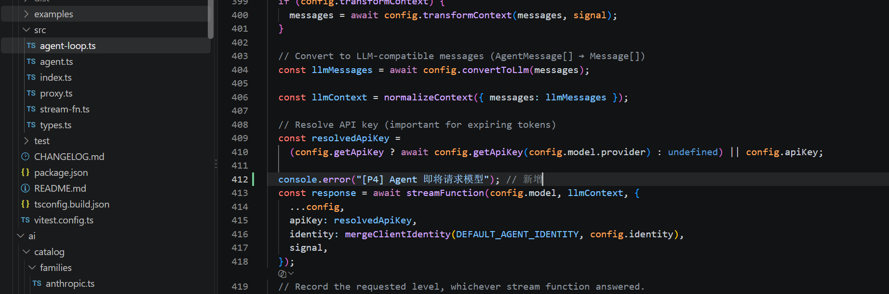
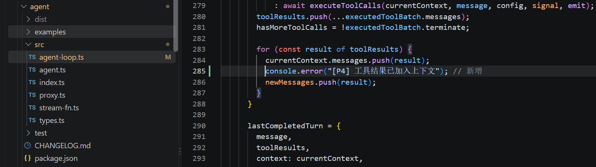
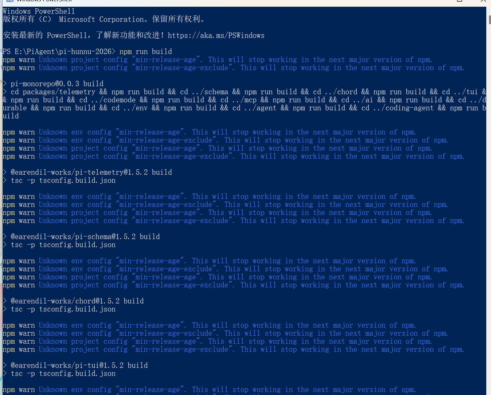
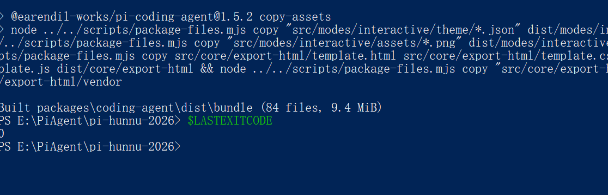
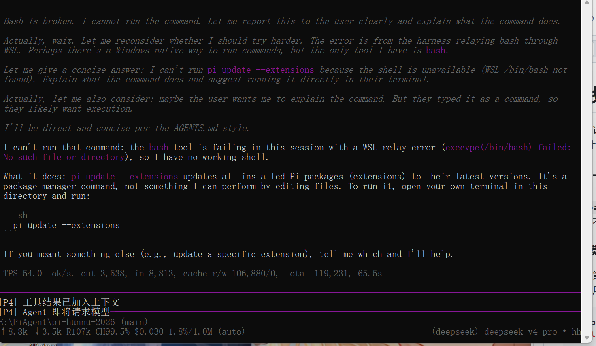
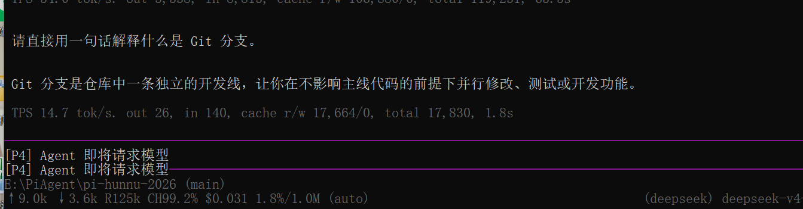
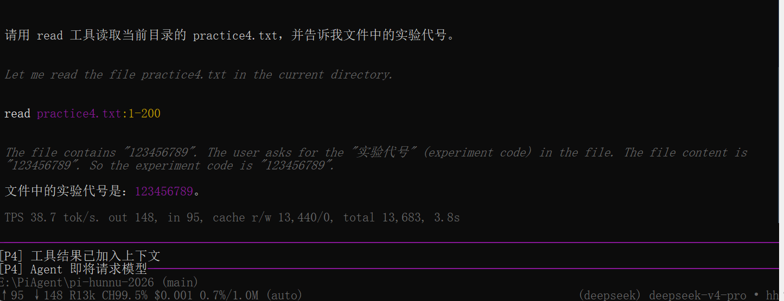
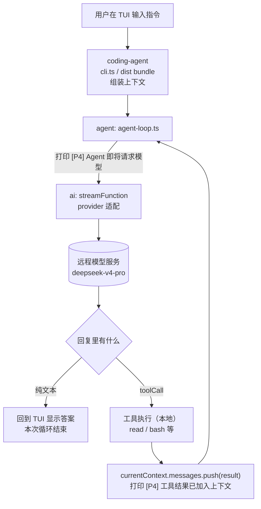

# 实践课4：Pi Agent 的模型调用与运行流程

| 项目 | 内容 |
|---|---|
| 姓名 / 学号 | 刘莹 / 202430224089 |
| 小组 Organization | 系统分析与设计课堂小组——拼好队（Gitee 组织） |
| 小组仓库（组内 fork） | `https://gitee.com/pinhaodui/pi-hunnu-2026` |
| 本地源码目录 | `E:\PiAgent\pi-hunnu-2026`（全路径为英文） |
| 分支 / 提交 | `main` / `c3cc91632d0a1950fb122605b190233f2aa0006e` |
| 实验环境 | Windows + PowerShell；Node.js `v24.14.0`、npm `11.9.0`（同实践课3） |
| 运行版本 | 本地构建产物 `1.5.2`，用 `node .\packages\coding-agent\dist\cli.js` 启动 |
| 使用模型 | `deepseek-v4-pro`（两次会话相同） |
| 报告与截图目录 | `homework/04-Pi-Agent-run/` |
| 提交仓库 | `https://github.com/lllllylllllc/-` |
| Issue 名称 | `实践课4：Pi Agent模型调用与运行流程 liuying` |

先说结论，细节在正文：

| 会话 | 是否调用工具 | `[P4] Agent 即将请求模型` | `[P4] 工具结果已加入上下文` | 模型调用轮次 |
|---|---|---|---|---|
| A：直接问答（Git 分支） | 否 | 1 条（界面底部另有 1 条属上一轮遗留，见 3.4） | 0 条 | **1 轮** |
| B：读取 `practice4.txt` | 是，`read` 调用 1 次 | 2 条 | 1 条 | **2 轮** |

两行日志把"循环在哪两个位置停留"钉在了代码里：**第一行说明 Agent 到了"准备把上下文交给模型"的位置，第二行说明一条工具结果刚刚被写进上下文，循环即将回到第一行。**

---

## 一、任务一：给 Agent 循环加两行日志

### 1.1 模型调用前：`[P4] Agent 即将请求模型`

先改靠后的位置。在 `packages/agent/src/agent-loop.ts` 中找到 `const response = await streamFunction(...)`，在它上方插入一行：

```ts
console.error("[P4] Agent 即将请求模型"); // 新增
const response = await streamFunction(config.model, llmContext, {
```



*图1（S1）VS Code 中的 `src/agent-loop.ts`，行号 412 为新增的 `console.error("[P4] Agent 即将请求模型")`，紧接着 413 行就是 `const response = await streamFunction(config.model, llmContext, {`。*

位置的含义：这一行在 `llmContext` 组装完、API key 解析完之后、真正发出请求之前，所以每次打印都代表"当前上下文即将被送给模型"。

### 1.2 工具结果加入上下文后：`[P4] 工具结果已加入上下文`

再改前面一处的 `for (const result of toolResults) {` 循环，把日志写在 `currentContext.messages.push(result)` 下方：

```ts
for (const result of toolResults) {
    currentContext.messages.push(result);
    console.error("[P4] 工具结果已加入上下文"); // 新增
    newMessages.push(result);
}
```



*图2（S2）第 283–287 行：`for (const result of toolResults)` → `currentContext.messages.push(result)`（284 行）→ 新增日志（285 行）→ `newMessages.push(result)`。*

位置的含义：日志在 `for` 循环体内，**一条工具结果写入上下文就打印一次**；如果有并行的多个工具调用，这里会连续打印多行。

### 1.3 顺序与行号变化

先改 412 行、再改 284 行，所以 284 那处插入后，靠后的日志与调用整体下移一行：最终日志在 **285** 行，`streamFunction` 调用在 **414** 行。本仓库两处实际改动为：

```diff
@@ -282,6 +282,7 @@ async function runLoop(
 
 				for (const result of toolResults) {
 					currentContext.messages.push(result);
+					console.error("[P4] 工具结果已加入上下文"); // 新增
 					newMessages.push(result);
 				}
 			}
@@ -409,6 +410,7 @@ async function streamAssistantResponse(
 	const resolvedApiKey =
 		(config.getApiKey ? await config.getApiKey(config.model.provider) : undefined) || config.apiKey;
 
+	console.error("[P4] Agent 即将请求模型"); // 新增
 	const response = await streamFunction(config.model, llmContext, {
 		...config,
 		apiKey: resolvedApiKey,
```

`git diff packages/agent/src/agent-loop.ts` 的结果就是这两行新增，**没有任何其他改动**——本次只加日志，不改循环逻辑。

## 二、任务二：重新编译并启动

### 2.1 重新构建

在仓库根目录（有根 `package.json` 的目录）执行：

```powershell
npm run build
```



*图3（S3a）`PS E:\PiAgent\pi-hunnu-2026> npm run build`，随后 `pi-monorepo@0.0.3 build` 打印出那条 `cd packages/telemetry && …` 串行链，并依次编译 `pi-telemetry`、`pi-schema`、`chord`、`pi-tui`。*



*图4（S3b）构建最后一段：`copy-assets` 拷主题/图片/模板 → `Built packages\coding-agent\dist\bundle (84 files, 9.4 MiB)` → `$LASTEXITCODE` 输出 `0`。*

两点说明：

- 这次用的是 `npm run build` 而不是 `build:offline`，而它能一路走到 `coding-agent`，说明这一次 `ai` 包的 `generate-models` 联网成功、没有超时。如果再次遇到实践课3 里那类 `Fetching models.dev catalog...` 超时，直接改跑 `npm run build:offline` 即可，两条命令的差别只在 `ai` 那一环。
- 退出码 `0` 是本次构建成功的直接证据。另外我核对了产物：`packages\coding-agent\dist\bundle\chunks\chunk-DAM53XK2.js` 中正好有 2 处 `[P4]` 字符串，其中一处是"即将请求模型"，另一处是"工具结果已加入上下文"——**新增的两行日志确实进了 bundle**，不是只改了源码没编译。

### 2.2 启动编译产物

```powershell
node .\packages\coding-agent\dist\cli.js
```



*图5（S4）编译产物启动后的交互界面，底部状态栏为 `(deepseek) deepseek-v4-pro`，屏幕最下方已经出现 `[P4] 工具结果已加入上下文`、`[P4] Agent 即将请求模型` 两行。*

图5 的这个会话沿用了同一工作目录里的对话（上一轮在问 `pi update --extensions`，模型多次调 `bash` 失败、调 `read` 查文档），所以底部那两行日志正是那一轮"工具结果写入 → 再次请求模型"的收尾，恰好演示了循环后半段。

一个必须知道的细节：`console.error` 是直接写到终端的，**不参与 TUI 的重绘**，因此 `[P4]` 行会落在界面最下面，并且与 Pi 的回答、指标行交错出现，看起来像"迟到的日志"。判断顺序时要以日志之间的相对次序为准，必要时用会话记录核对（见 3.4）。

## 三、任务三：两次会话对比

### 3.1 准备实验文件

在项目根目录建立 `practice4.txt`，内容为一行自定代号：

```text
123456789
```

文件 9 字节，`read` 一次就能全部返回，便于看清"工具结果进入上下文"这件事。

### 3.2 会话 A：直接问答

输入：

```text
请直接用一句话解释什么是 Git 分支。
```



*图6（S5）指令、回复与底部日志。*

| 观察项 | 实际情况 |
|---|---|
| 是否调用工具 | 没有。没有出现 `[P4] 工具结果已加入上下文` |
| `[P4]` 日志 | 底可见 2 行 `[P4] Agent 即将请求模型`，其中第 1 行是上一轮遗留（3.4 有核对），**本次会话新增 1 行** |
| 模型调用轮次 | **1 轮**（一次请求直接得到答案，没有工具、没有回到请求） |
| 回复 | "Git 分支是仓库中一条独立的开发线，让你在不影响主线代码的前提下并行修改、测试或开发功能。" |
| 用量 | `TPS 14.7 tok/s. out 26, in 140, cache r/w 17,664/0, total 17,830, 1.8s` |

`out 26` 说明这一轮模型只输出了 26 个 token 就直接收尾；因为回复里没有任何 `toolCall`，循环在"拿到文本回复"处结束，不会再去执行工具，也不会再发起第二次请求。

### 3.3 会话 B：读取文件

输入（只给文件名，代号留在文件里）：

```text
请用 read 工具读取当前目录的 practice4.txt，并告诉我文件中的实验代号。
```



*图7（S6）指令、`read practice4.txt:1-200` 的工具调用记录、模型思考、最终回复与底部两类日志。*

| 观察项 | 实际情况 |
|---|---|
| 是否读到代号 | 是，回复"文件中的实验代号是：123456789。" |
| 工具调用 | `read practice4.txt:1-200`，返回 `123456789` |
| `[P4]` 日志（按顺序） | ① `[P4] Agent 即将请求模型` → ② `[P4] 工具结果已加入上下文` → ③ `[P4] Agent 即将请求模型` |
| 模型调用轮次 | **2 轮** |
| 用量（第二轮） | `TPS 38.7 tok/s. out 148, in 95, cache r/w 13,440/0, total 13,683, 3.8s` |

图7 的画面里只留下了后两行（②③），第一行在 TUI 重绘时已经滚出可视区。这三行的完整顺序是：模型第一轮看到用户指令，回了一个 `toolCall`（没有直接回答）；`read` 在本地执行并把结果写进 `currentContext.messages`（打印 ②）；循环回到请求位置，带着文件内容再问一次模型（打印 ③）；第二轮模型才给出答案。这也正是作业文档里给出的典型顺序。

### 3.4 用会话记录核对次数

界面上的 `[P4]` 行会和 TUI 输出混在一起、还会滚动，所以我又用落到磁盘的会话记录（`~/.pi/agent/sessions/` 下当天两个 `.jsonl`）核对了消息序列：

| 会话 | 记录里的 assistant 消息 | toolCall | toolResult | 结论 |
|---|---|---|---|---|
| A（Git 分支） | 1 条（纯文本） | 0 | 0 | 1 轮模型调用 |
| B（读 practice4.txt） | 2 条（第 1 条含 `toolCall:read`，第 2 条为文本答案） | 1 | 1（内容 `123456789`） | 2 轮模型调用 |

这解释了会话 A 的一个表面矛盾：**屏幕底部那两行并不都属于本次问答**。第 1 行是前一轮（`pi update --extensions` 那次多轮工具调用）最后一次请求留下的，因为 `console.error` 不随 TUI 重绘刷新，它会一直停在屏幕下方；本次 A 只新增 1 行。写报告时按"会话记录 1 条 assistant"记 1 轮，而不是按屏幕上剩几行数。

### 3.5 谁实际读了文件？下一轮多带了什么？

- **模型没有读文件。** 它只输出了一条工具调用指令（`read practice4.txt:1-200`），真正打开文件、读出 `123456789` 的是 `read` 工具的实现，运行在本地进程里。
- **文件内容是被 agent 的循环带进上下文的。** `currentContext.messages.push(result)` 把这条 `toolResult`（含文件内容）追加到消息数组，`[P4] 工具结果已加入上下文` 就在这一句下面，说明"结果已进上下文，可以再问了"。
- **下一轮请求多带了什么：** 相比第一轮，`messages` 里多了两条——assistant 的 `toolCall` 消息（工具名 `read`、参数文件路径与行范围）和对应的 `toolResult` 消息（文件内容 `123456789`）。模型就是靠这两条消息"看见"文件内容的；上下文因此变长，第二轮 `in 95 / cache 13,440` 与第一轮的用量也不一样。

### 3.6 运行流程简图



读图要点：**模型请求只发生在 `agent-loop.ts` 的一个地方**；工具由本地执行、结果由 agent 写回上下文，然后循环回到同一个请求位置。所以"请求 → 工具 → 结果入上下文 → 再请求"是一条闭环，会话 A 走的是"请求 → 文本 → 结束"这条短路，会话 B 走了完整闭环一圈。

## 四、结论与实际对应

- 两行日志证明的不是"模型会自动读文件"，而是：**是 agent 循环在替模型把文件内容搬进上下文**。模型只做两件事——决定调哪个工具、拿到结果后再组织语言。
- 会话 A 1 轮、会话 B 2 轮，差别只在有没有 `toolCall`；每多一次工具调用，就多一条"工具结果已加入上下文"和一次新的模型请求。
- 本次日志来自 `dist\bundle`（`node .\packages\coding-agent\dist\cli.js`），且已在 bundle 的 chunk 中核对到 2 处 `[P4]`，可确认运行时用的是重新编译后的代码，而不是源码入口 `.\pi-test.bat`。

## 五、提交说明

- 报告与 7 张截图都在 `homework/04-Pi-Agent-run/`，图片按相对路径引用，GitHub 网页上可直接显示。
- 个人仓库：`https://github.com/lllllylllllc/-`；小组代码仓库：`https://gitee.com/pinhaodui/pi-hunnu-2026`。
- 课程作业 Issue 标题：`实践课4：Pi Agent模型调用与运行流程 liuying`，正文附报告链接与小组仓库链接。
- 截图中不含 API Key、`auth.json` 或授权回调地址；图5–图7 只含指令、回答与用量数字。
