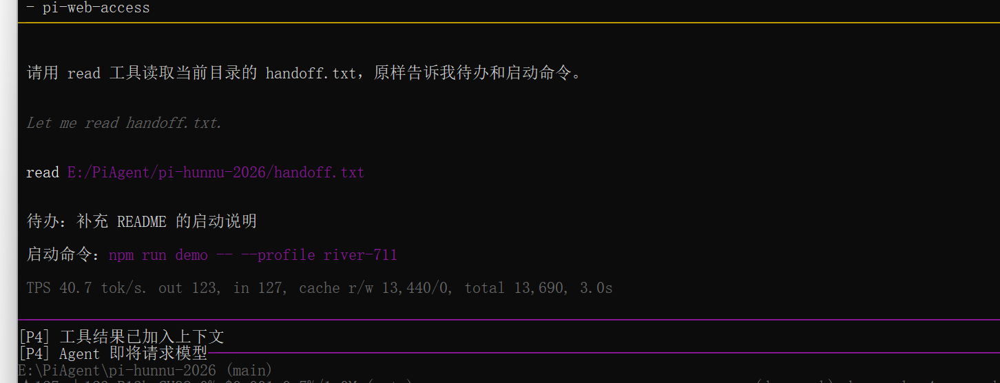
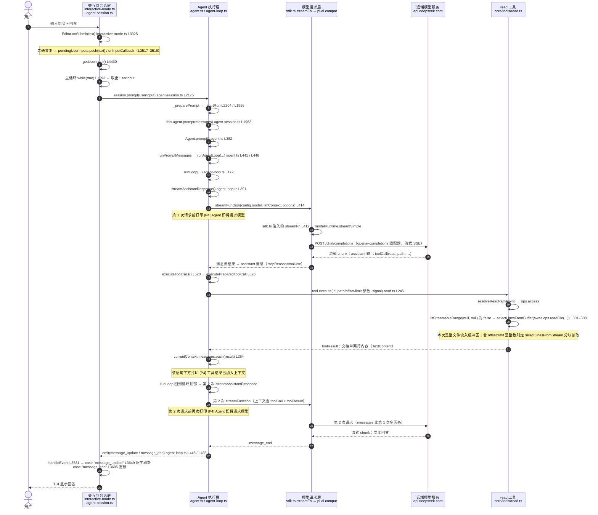
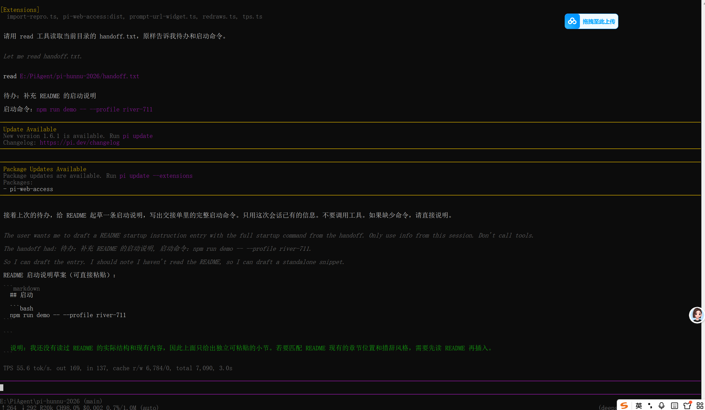
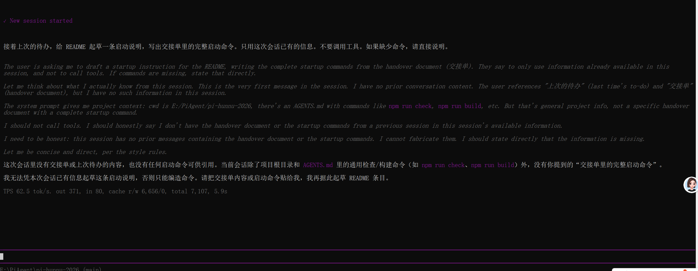
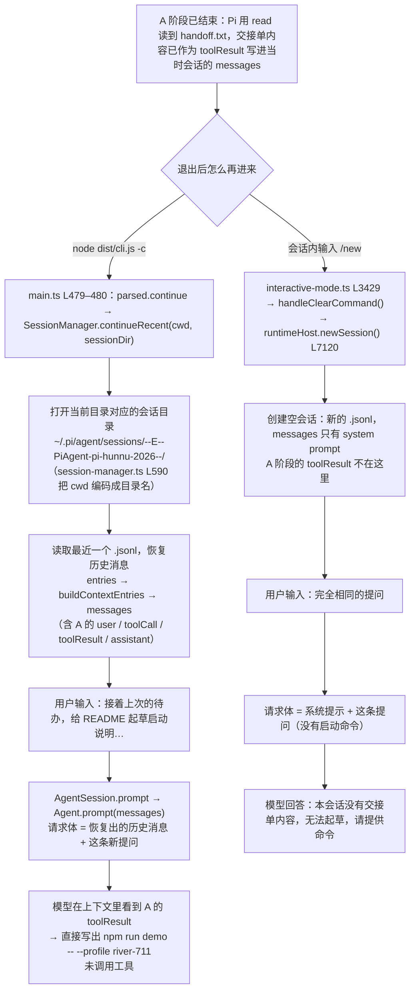

# 实践 05：Pi Agent 源码泛读与功能定位

| 项目 | 内容 |
|---|---|
| 姓名 / 学号 | 刘莹 / 202430224089 |
| 小组 Organization | 系统分析与设计课堂小组——拼好队（Gitee 组织） |
| 小组仓库（组内 fork） | `https://gitee.com/pinhaodui/pi-hunnu-2026` |
| 本地源码目录 | `E:\PiAgent\pi-hunnu-2026` |
| 分支 / 提交 | `main` / `c3cc91632d0a1950fb122605b190233f2aa0006e` |
| 实验环境 | Windows + PowerShell；Node.js `v24.14.0`、npm `11.9.0` |
| 运行方式 | `node .\packages\coding-agent\dist\cli.js`（本地构建产物 `1.5.2`，沿用实践 04 带 `[P4]` 日志的构建） |
| 使用模型 | `deepseek-v4-pro`（provider `deepseek`，api `openai-completions`，`https://api.deepseek.com`） |
| 报告与截图目录 | `homework/05-Pi-Agent-source-reading/` |
| 提交仓库 | `https://github.com/lllllylllllc/-` |
| Issue 名称 | `实践课5：Pi Agent工具调用与会话恢复 liuying` |

本次要回答三个问题：一次提问里，功能入口在哪、调用链怎么走、改哪里最合适；以及"恢复旧会话"和"新建会话"在源码上到底差在哪一步。

先给实测结论（细节见后文）：

| 阶段 | 输入 | 工具调用 | 模型请求 | 结果 |
|---|---|---|---|---|
| A 单轮读取 | 读取 `handoff.txt`，原样说出待办与启动命令 | `read` 1 次 | 2 次 | 读到"待办：补充 README 的启动说明 / 启动命令：`npm run demo -- --profile river-711`" |
| B1 恢复旧会话（`-c`） | 接着上次待办起草 README 启动说明，只用本会话信息、不调工具 | 0 次 | 1 次 | 写出完整命令 `npm run demo -- --profile river-711`，未重新读文件 |
| B2 新建会话（`/new`） | 完全相同的提问 | 0 次 | 1 次 | 明确回答"这次会话里没有交接单内容"，无法起草 |

---

## 一、A 阶段：单轮交互与工具调用

```text
待办：补充 README 的启动说明
启动命令：npm run demo -- --profile river-711
```

启动本地构建的 Pi 后（新会话），输入：

```text
请用 read 工具读取当前目录的 handoff.txt，原样告诉我待办和启动命令。
```



*图 0（A 阶段现场）提示词、`read E:/PiAgent/pi-hunnu-2026/handoff.txt` 的工具调用记录、回答，以及底部的 `[P4] 工具结果已加入上下文`、`[P4] Agent 即将请求模型`。*

从现场能直接读出三件事：

1. **工具确实执行了 1 次**：模型发出 `read` 调用，参数是 `{"path":"E:/PiAgent/pi-hunnu-2026/handoff.txt","offset":null,"limit":null}`（来自会话记录），返回的就是交接单两行内容。
2. **这一轮里有 2 次模型请求**：第一次返回 `toolCall`（没有文本答案），第二次带着工具结果才给出回答。底部两条 `[P4]` 日志正好对应"结果入上下文 → 再请求"。
3. **用量**：`TPS 40.7 tok/s. out 123, in 127, cache r/w 13,440/0, total 13,690, 3.0s`，其中 `out 123` 是第二次请求的输出。

### 图 1：单轮工具调用的代码级时序图



读图要点：

- **输入入口**在 `interactive-mode.ts` 的 `Editor.onSubmit`（L3325）；普通文本并不是在这里直接请求模型，而是先入队（L3519），由主循环 `getUserInput()`（L4430）取出后交给 `session.prompt()`（L1296）。这一层"输入与执行分离"的设计，才让流式过程中还能排队消息。
- **启动循环**的关键一跳是 `AgentSession.prompt`（L2175）→ `_startRun`（L1956）→ `Agent.prompt()`（`agent.ts` L382）→ `runPromptMessages`（L441）→ `runAgentLoop`（`agent-loop.ts` L133）→ `runLoop`（L172）。真正的"请求—工具—再请求"循环体在 `runLoop` 里。
- **模型与文件边界**：`streamFunction`（`agent-loop.ts` L414）是唯一发请求的地方；它由 `coding-agent/src/core/sdk.ts` 注入（`setDefaultStreamFn(streamSimple)` L46，具体实现 L412），最终落到 `pi-ai` 的 `compat.ts` 适配器，按 `model.api` 选到 `openai-completions`，向 `api.deepseek.com` 发流式请求。文件系统调用全部在 `read` 工具内部，与模型请求层没有直接接触。
- **显示回复**在 `interactive-mode.ts`：`subscribeToAgent()`（L3525）订阅会话事件 → `handleEvent()`（L3531）→ `message_update`（L3649，`streamingComponent.updateContent` 逐字刷新）与 `message_end`（L3685，定稿并落盘）。

## 二、B 阶段：恢复旧会话 vs 新建会话

### 1. 恢复原会话

退出 Pi，在同一个项目目录用 `-c` 重新打开：

```powershell
node .\packages\coding-agent\dist\cli.js -c
```

终端里能直接看到 A 阶段的完整记录（提问、`read` 调用、交接单内容）。接着输入：

```text
接着上次的待办，给 README 起草一条启动说明，写出交接单里的完整启动命令。只用这次会话已有的信息。不要调用工具。如果缺少命令，请直接说明。
```



*图 1（B1）`-c` 恢复后，屏幕上还留着 A 阶段的问答；新提问之后，模型直接给出了含 `npm run demo -- --profile river-711` 的 README 草稿。*

- 有没有调用工具：**没有**，界面没有新的 `read` 记录，会话记录里也没有新增 `toolCall`。
- 回答（节选）：给出的是一段可直接粘贴的 markdown，代码块里就是 `npm run demo -- --profile river-711`；末尾还补充"我还没有读过 README 的实际结构和现有内容，因此上面只给出独立可粘贴的小节"。
- 用量：`TPS 55.6 tok/s. out 169, in 137, cache r/w 6,784/0, total 7,090, 3.0s`。

因为它拿得出 A 阶段读到的完整命令、又没有重新读文件，这就是"用了恢复出来的会话历史"的直接证据。

### 2. 新建会话

在同一个窗口直接 `/new`，界面提示 `New session started`，再输入**完全相同**的话：



*图 2（B2）`/new` 之后的历史是空的，同样的提问得到的是"本会话没有交接单内容，无法起草"。*

- 有没有调用工具：**没有**。
- 回答（节选）："这次会话里没有交接单或上次待办的内容，也没有任何启动命令可供引用……我无法凭本次会话已有信息起草这条启动说明，否则只能编造命令。"
- 用量：`TPS 62.5 tok/s. out 371, in 80, cache r/w 6,656/0, total 7,107, 5.9s`。

两次对照很清楚：**同一目录、同一模型、同一句话，唯一变量是"聊天历史里有没有 A 阶段那两条工具消息"**。


### 图 2：恢复旧会话与新建会话的对照图



关键差别一句话：**两者的区别不在模型，而在 `messages` 数组里有没有 A 阶段那条 `toolResult`**。`-c` 从会话文件把它读回来了；`/new` 换了一个空的历史。


## 三、结论

1. **一次用户输入是一轮交互，但可以包含多次模型调用**。A 阶段是 1 次用户输入 → 2 次模型请求（`toolCall` 一次、带结果回答一次），两次请求之间夹着 1 次 `read` 工具执行。日志顺序与源码完全对得上：`[P4] Agent 即将请求模型` 在 `streamFunction` 之前，`[P4] 工具结果已加入上下文` 在 `messages.push(result)` 之后。
2. **谁读了文件**：不是模型，是 `read` 工具在本地进程里读的（本次走 `fs.readFile` 缓冲区路径）；模型只发出了 `read` 的参数。
3. **恢复与新建的唯一区别**：`-c` 把 A 阶段的 `user / toolCall / toolResult / assistant` 从会话文件恢复进 `messages`，所以第二次提问的请求体里带着启动命令；`/new` 的 `messages` 里没有这些，模型就只能说"缺少信息"。
4. **本次改动的落点建议**：验证"输入 → 循环 → 工具 → 显示"这条链路，最省事的是在 `runLoop`/`streamAssistantResponse` 与 `read.ts` 的 `execute` 里加日志；要动行为则应分别落在 `onSubmit`（输入）、`runLoop`（循环）、`createReadToolDefinition`（工具）、`sdk.ts streamFn`（模型接入）、`handleEvent`（显示）五处之一，避免把逻辑堆到同一层。
